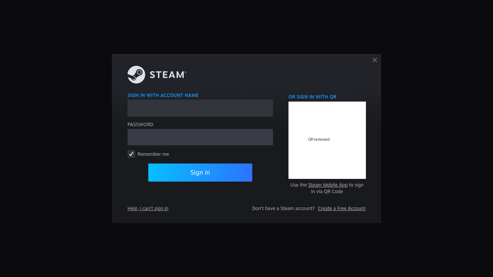

# Performance

## Targets (from the brief; not achievements)

| | Target |
|---|---|
| Render resolution | 720p (default `1280x720`) |
| Baseline | 30 FPS where the game and compatibility layers allow |
| Stretch | 60 FPS |
| Audio | stable, with no underruns |
| Input | responsive. Controller packets travel on their own channel, outside the request path. |

**No iPad measurements exist yet.** Nothing below estimates FPS.

## What iDeck measures

| Metric | Source | Shown in |
|---|---|---|
| Game FPS, frame time | MangoHud inside Linux (Vulkan layer) | over the game (Settings › FPS overlay) |
| Guest CPU %, per core | agent `/proc/stat`, every 2 s | Performance, Runtime |
| Guest memory | agent `/proc/meminfo` | Performance |
| iDeck footprint, headroom | `task_vm_info.phys_footprint`, `os_proc_available_memory()` | Performance |
| Memory pressure and actions taken | DispatchSource memory pressure plus headroom thresholds | Performance |
| Thermal state | `ProcessInfo.thermalState` (exact temperatures are not exposed to apps) | Performance |
| Battery and drain rate | `UIDevice.batteryLevel` over time | Performance |
| GPU utilisation | **not measurable**: iPadOS exposes no API, so iDeck shows none | — |
| CPU micro-benchmarks | `ideck-bench` in the guest | Performance › CPU benchmark |

## Optimisations implemented

- **Memory:** jetsam-aware guest sizing; a bounded TCG cache; balloon with free-page reporting; on pressure the guest drops caches, the balloon inflates, disks sync and UI caches are released. Journald runs in RAM; `vm.swappiness=0`.
- **CPU:** MTTCG; the `neoverse-n1` model avoids PAuth/SVE emulation costs (V1, N2 and A710 start with `pauth=off,sve=off` since build 28); performance profiles set 2, 4 or 6 vCPUs; the agent's input path runs on its own thread.
- **Kernel:** `mitigations=off nowatchdog kpti=0 transparent_hugepage=never`. `kpti=0` (build 28 / runtime 0.1.9) made system calls 7× faster in CI; see below.
- **GPU:** zero-copy SPICE GL scanout into an MTKView; frames are presented on display refresh (`preferredFramesPerSecond = 120`) and drawn only when new.
- **Storage:** raw sparse images with `discard=unmap`, `detect-zeroes=unmap`, `aio=threads`; no qcow2 overhead; APFS clones for snapshots.
- **Background work:** apt/man/fstrim timers are masked, and no desktop environment runs.
- **Thermal:** the profile is user-selectable. Automatic throttling based on `thermalState` is a planned extension, not implemented.

## Host baseline (measured in this session)

`ideck-bench` built natively for Windows x86-64 and run on the development PC
(Intel Core i5-14600K, 20 threads). This **is not iPad data**; it is the native
reference point for the same code.

| Benchmark | Result |
|---|---|
| int_single | 2344 Mops/s |
| fp_single (384×384 matmul) | 9692 MFLOP/s |
| int_multi (20 threads) | 16110 Mops/s (6.87× single) |
| mem_bandwidth (memcpy 64 MiB) | 4590 MB/s |
| mem_read | 8710 MB/s |
| mem_latency (random, 64 MiB) | 106.7 ns |
| ipc | 9.67 Gops/s |
| syscall, jit_translate | not measured on Windows |

## Guest under TCG (measured in CI, not an iPad)

The same benchmark inside the guest under QEMU 8.2 TCG on a GitHub
`ubuntu-24.04-arm` runner (run 42999579844, 4 vCPU, `neoverse-n1` model):

| Benchmark | TCG guest | Note |
|---|---|---|
| int_single | 2698 Mops/s | integer code translates efficiently |
| fp_single | 220 MFLOP/s | soft-float helpers: the main FP bottleneck |
| int_multi (4 vCPU) | 10171 Mops/s (3.77×) | MTTCG scales |
| mem_bandwidth (memcpy) | 366 MB/s | byte-wise helper copies |
| mem_read | 3702 MB/s | |
| mem_latency | 523 ns | softmmu TLB walk on misses |
| syscall | 25.4 µs | full exception round trip |
| ipc | 2.16 Gops/s | |
| jit_translate | 14.1 µs per block cold, 0.37 µs warm | |

Booting to the agent took 34 s. These describe TCG on a Neoverse server
core. An M5 run is needed for iPad figures, and FP/memcpy-heavy games will
feel these costs most.

## Kernel page-table isolation: `kpti=0` (runtime 0.1.9, measured in CI)

**Cause.**
- Linux 6.12 decides KPTI in `unmap_kernel_at_el0()`. When KASLR is active and the CPU lacks E0PD, it forces KPTI on, and only afterwards looks at `mitigations=off`.
- QEMU's `virt` machine passes a KASLR seed, and QEMU's `neoverse-n1` and `neoverse-v1` models have no E0PD.
- With KPTI on, every switch between user and kernel mode changes the ASID in TTBR1. QEMU's TCG does not model ASIDs, so each change flushes its whole soft TLB.
- The `kpti=0` boot parameter overrides this.

**Evidence.** The agent now reports the kernel's own message (on device: the `guest agent ready` line in `ideck.log`):
- without the parameter: `CPU features: kernel page table isolation forced ON by KASLR`;
- with it: `… forced OFF by kpti command line option`.

**A/B run** (`runtime.yml` run 43218566550): GitHub `ubuntu-24.04-arm` runner, Ubuntu's QEMU 8.2 TCG, 4 vCPU, 4 GiB. No provisioning (`ideck.noprovision`). The kernel command line was identical apart from the change, with `mitigations=off nowatchdog` in both, as on the device since build 24. One run each.

| Benchmark | N1, KPTI on (as before) | N1, `kpti=0` | Change | V1 `pauth=off,sve=off`, `kpti=0` |
|---|---|---|---|---|
| Boot to agent | 33.2 s | 21.8 s | −34% | 22.1 s |
| syscall (`getppid`) | 20,689 ns | 2,907 ns | **7.1× faster** | 2,822 ns |
| mem_latency (random, 64 MiB) | 426 ns | 206 ns | 2.1× faster | 195 ns |
| mem_bandwidth (memcpy) | 388 MB/s | 1,106 MB/s | 2.9× | 913 MB/s |
| mem_read | 3,608 MB/s | 4,460 MB/s | +24% | 4,390 MB/s |
| int_single | 2,751 Mops/s | 2,924 Mops/s | +6% | 2,965 Mops/s |
| fp_single | 198 MFLOP/s | 158 MFLOP/s | −20% (see below) | 163 MFLOP/s |
| int_multi (4 threads) | 3,700 Mops/s | 3,160 Mops/s | −15% (see below) | 2,893 Mops/s |

**Reading the numbers.**
- System calls, memory latency and memcpy move the most. With KPTI, the timer interrupts alone flushed the TLB many times a second.
- KPTI has no mechanism that touches `fp_single` or `int_multi`. Their changes look like runner noise: the full boot test of the same image measured `int_multi` at 6,299, and 0.1.8's at 6,673.
- V1 without PAuth/SVE is in the same range as N1, so N1 stays the default.

**Full boot test, same runtime** (0.1.8 → 0.1.9, both with Steam installed during the test):
- syscall: 22,426 → 2,550 ns.
- Boot to agent: 32.3 → 22.7 s.
- Setup (Steam, FEX RootFS, self-test): 485 → 445 s, even though setup now also decodes the VZ packages.
- **Steam UI:**
  - 0.1.8: CI showed only "Steamwebhelper is not responding" while the client re-downloaded and extracted itself.
  - 0.1.9: Steam's real sign-in window was on screen about 156 s after Steam started. Screenshots are 2 min apart, so it may have appeared earlier. The QR code is blanked in the copy below.

These are CI numbers on a Neoverse server core. The iPad gets `kpti=0` from build 28 with any runtime, and its `guest agent ready` line shows whether KPTI is off.

## Lighter Linux and Steam: research of 2026-11-12, not yet done

Ordered by expected gain. None of these has been measured yet.

1. **FEX settings for x86 games** (`~/.fex-emu`, per game via `AppConfig/`):
   - `X87ReducedPrecision` for x87-era games;
   - per-game `TSOEnabled=0`, which FEX itself calls unstable;
   - `DiskCache`, FEX's code cache (FEX 2609; Valve enabled it for Proton Experimental ARM).
   - Open question: whether the FEX that Steam's ARM64 client runs reads these files. Needs a game test on the device.
2. **Steam launch flags.** `-cef-disable-hang-timeouts`, `-cef-in-process-gpu`, `-cef-disable-site-isolation` and `-cef-disable-js-logging` exist in the client's option list. Each one needs an A/B run on the device; any of them could crash the web helper.
3. **Keep Steam's UI idle while a game runs.** I found no evidence that Steam pauses `steamwebhelper` during play. Minimising Steam's windows, or starting with `-silent` once signed in, would leave the CPU to the game. Behaviour under openbox (no tray) is unknown.
4. **`-noshaders` / no shader pre-caching.** Fossilize already runs at idle priority. Under MoltenVK the host compiles shaders anyway, so pre-caching is probably wasted work.
5. **`-cpu max,pauth=off,sve=off,sme=off`.** It has E0PD and FEAT_MOPS, and glibc 2.41 uses MOPS `memcpy`, which QEMU implements with host `memmove`. It could raise memcpy further. Risk: many more CPU features under emulation.
6. **Smaller kernel options:** `audit=0`, `init_on_alloc=0`. Probably small gains.

Not recommended:
- gamescope: needs Vulkan compositing, which UTM reports as broken.
- Dropping PipeWire: Steam needs pipewire-pulse.
- Turning transparent huge pages back on: QEMU's softmmu handles them badly.

## Benchmark plan for games

Measure separately at 720p:

1. **2D:** a native ARM64 or GL title
2. **Moderate 3D:** an older D3D9/GL title
3. **Demanding 3D:** a recent D3D11/12 title

For each, record average FPS, 1% lows (MangoHud), guest CPU %, iDeck footprint,
thermal state after 30 minutes, and battery drain. Write results to
[TEST_RESULTS](TEST_RESULTS.md) and `compat.json`.
