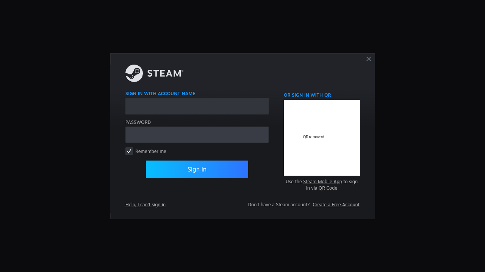

# Performance

## Targets (from the brief; not achievements)

| | Target |
|---|---|
| Render resolution | 720p (default `1280x720`) |
| Refresh rate | 60 Hz by default; 30 and 120 Hz selectable (120 on ProMotion displays) |
| Baseline | 30 FPS where the game and compatibility layers allow |
| Stretch | 60 FPS |
| Audio | stable, with no underruns |
| Input | responsive. Controller packets travel on their own channel, outside the request path. |

**No iPad measurements exist yet.** Nothing below estimates FPS.

## What iDeck measures

| Metric | Source | Shown in |
|---|---|---|
| Game FPS, frame time | MangoHud inside Linux (Vulkan layer) | over the game (Settings › FPS overlay) |
| Guest CPU %, per core | agent `/proc/stat`, every 2 s | Performance, Runtime |
| Guest memory | agent `/proc/meminfo` | Performance |
| iDeck footprint, headroom | `task_vm_info.phys_footprint`, `os_proc_available_memory()` | Performance |
| Memory pressure and actions taken | DispatchSource memory pressure plus headroom thresholds | Performance |
| Thermal state | `ProcessInfo.thermalState` (exact temperatures are not exposed to apps) | Performance |
| Battery and drain rate | `UIDevice.batteryLevel` over time | Performance |
| GPU utilisation | **not measurable**: iPadOS exposes no API, so iDeck shows none | — |
| CPU micro-benchmarks | `ideck-bench` in the guest | Performance › CPU benchmark |
| Floating-point instructions against hardware | `ideck-fpcheck` in the guest (agent `fpcheck.run`) | Settings › Advanced, `ideck.log` |

## Optimisations implemented

- **Memory:** jetsam-aware guest sizing; a bounded TCG cache; balloon with free-page reporting; on pressure the guest drops caches, the balloon inflates, disks sync and UI caches are released. Journald runs in RAM; `vm.swappiness=0`.
- **Native floating point** (build 38; off by default from build 42, not yet run on a device): the embedded QEMU carries iDeck's engine patch. Linux's floating-point and vector math instructions run on the iPad's CPU instead of in QEMU's software routines. In CI, floating-point loops ran 2.4–7.3× faster and all 189 instruction patterns gave the same bits as real hardware. See [CPU_ENGINE](CPU_ENGINE.md#native-floating-point-build-38).
- **Fast process switching** (build 38; off by default from build 42, not yet run on a device): QEMU keeps the kernel's address translations when Linux switches between programs instead of rebuilding all of them. In CI a switch went from 99 µs to 29 µs. See [CPU_ENGINE](CPU_ENGINE.md#process-switches-build-38).
- **CPU:** MTTCG; the `neoverse-n1` model avoids PAuth/SVE emulation costs (V1, N2 and A710 start with `pauth=off,sve=off` since build 28); performance profiles set 2, 4 or 6 vCPUs; the agent's input path runs on its own thread.
- **Kernel:** `mitigations=off nowatchdog kpti=0 transparent_hugepage=never`. `kpti=0` (build 28 / runtime 0.1.9) made system calls 7× faster in CI; see below.
- **Steam's UI only while it is on screen** (build 29 / runtime 0.1.9; in the guest agent from runtime 0.1.11, which halved its own overhead, see [STEAM](STEAM.md#steams-ui-only-while-it-is-on-screen)):
  - Steam's windows are minimised while the iPad shows iDeck's screens or a game, so Chromium stops drawing them.
  - `steamwebhelper` runs at nice 19 during games.
  - CI, sign-in window: guest CPU 22.5% shown, 13.5% hidden, 18.5% shown again (4 vCPUs, 60 s averages).
  - Details in [STEAM](STEAM.md#steams-ui-only-while-it-is-on-screen).
- **No second Steam install after setup** (runtime 0.1.9): the bootstrap keeps Steam's package files and its installed-manifest copy. The client's first start now skips the 574 MB re-download and the 5–7 minutes of extraction.
- **TCG cache sized from memory headroom** (build 31): up to 1 GiB instead of 384 MiB, which cut cache flushes about fourfold in CI. See [below](#tcg-cache-flushes-measured-in-ci).
- **Steam's UI on every vCPU** (runtime 0.1.10):
  - Steam's `steamrtarm64/steamwebhelper.sh` runs `taskset 0x7c`, pinning the whole Chromium UI to CPUs 2–6 (Steam Frame's big cores). In the VM that is 2 of 4 vCPUs, 4 of 6, and no CPU at all with 2.
  - `ideck-steam-launch` puts `/usr/lib/ideck/steam-path` first in Steam's PATH. Its `taskset` starts the web helper unpinned and passes every other call to util-linux. This keeps working after Steam updates itself.
  - CI: `Cpus_allowed_list` of the web helper is 2-3 pinned and 0-3 with the override. The sign-in window after a Steam restart took 90.7 s pinned and 79.0 s unpinned in GPU mode, and 66.6 s against 66.5 s with the software UI. The sign-in screen does little work in parallel; the library does more.
- **GPU:** zero-copy SPICE GL scanout into an MTKView, presented at the chosen refresh rate.
- **Refresh rate** (build 38 with runtime 0.1.14): Settings › Display offers 30, 60 and, on ProMotion displays, 120 Hz. Linux's X server paces its programs at that rate and the Metal view presents at it.
  - Until build 36 the setting had no effect: the view always presented at 60 and Linux ran at its default mode. An earlier version of this page said the view presented at 120; the code said 60.
  - 120 Hz lets a game that can draw more than 60 frames a second show them. It does not make anything draw faster, and Steam's own interface then tries to animate at 120, which costs CPU. 60 stays the default.
- **Storage:** raw sparse images with `discard=unmap`, `detect-zeroes=unmap`, `aio=threads`; no qcow2 overhead; APFS clones for snapshots.
- **Background work:** apt/man/fstrim timers are masked, and no desktop environment runs.
- **Thermal:** the profile is user-selectable. Automatic throttling based on `thermalState` is a planned extension, not implemented.

## Host baseline (measured in this session)

`ideck-bench` built natively for Windows x86-64 and run on the development PC
(Intel Core i5-14600K, 20 threads). This **is not iPad data**; it is the native
reference point for the same code.

| Benchmark | Result |
|---|---|
| int_single | 2344 Mops/s |
| fp_single (384×384 matmul) | 9692 MFLOP/s |
| int_multi (20 threads) | 16110 Mops/s (6.87× single) |
| mem_bandwidth (memcpy 64 MiB) | 4590 MB/s |
| mem_read | 8710 MB/s |
| mem_latency (random, 64 MiB) | 106.7 ns |
| ipc | 9.67 Gops/s |
| syscall, jit_translate | not measured on Windows |

## Guest under TCG (measured in CI, not an iPad)

The same benchmark inside the guest under QEMU 8.2 TCG on a GitHub
`ubuntu-24.04-arm` runner (run 42999579844, 4 vCPU, `neoverse-n1` model):

| Benchmark | TCG guest | Note |
|---|---|---|
| int_single | 2698 Mops/s | integer code translates efficiently |
| fp_single | 220 MFLOP/s | soft-float helpers: the main FP bottleneck |
| int_multi (4 vCPU) | 10171 Mops/s (3.77×) | MTTCG scales |
| mem_bandwidth (memcpy) | 366 MB/s | byte-wise helper copies |
| mem_read | 3702 MB/s | |
| mem_latency | 523 ns | softmmu TLB walk on misses |
| syscall | 25.4 µs | full exception round trip |
| ipc | 2.16 Gops/s | |
| jit_translate | 14.1 µs per block cold, 0.37 µs warm | |

Booting to the agent took 34 s. These describe TCG on a Neoverse server
core. An M5 run is needed for iPad figures, and FP/memcpy-heavy games will
feel these costs most.

## Kernel page-table isolation: `kpti=0` (runtime 0.1.9, measured in CI)

**Cause.**
- Linux 6.12 decides KPTI in `unmap_kernel_at_el0()`. When KASLR is active and the CPU lacks E0PD, it forces KPTI on, and only afterwards looks at `mitigations=off`.
- QEMU's `virt` machine passes a KASLR seed, and QEMU's `neoverse-n1` and `neoverse-v1` models have no E0PD.
- With KPTI on, every switch between user and kernel mode changes the ASID in TTBR1. QEMU's TCG does not model ASIDs, so each change flushes its whole soft TLB.
- The `kpti=0` boot parameter overrides this.

**Evidence.** The agent now reports the kernel's own message (on device: the `guest agent ready` line in `ideck.log`):
- without the parameter: `CPU features: kernel page table isolation forced ON by KASLR`;
- with it: `… forced OFF by kpti command line option`.

**A/B run** (`runtime.yml` run 43218566550): GitHub `ubuntu-24.04-arm` runner, Ubuntu's QEMU 8.2 TCG, 4 vCPU, 4 GiB. No provisioning (`ideck.noprovision`). The kernel command line was identical apart from the change, with `mitigations=off nowatchdog` in both, as on the device since build 24. One run each.

| Benchmark | N1, KPTI on (as before) | N1, `kpti=0` | Change | V1 `pauth=off,sve=off`, `kpti=0` |
|---|---|---|---|---|
| Boot to agent | 33.2 s | 21.8 s | −34% | 22.1 s |
| syscall (`getppid`) | 20,689 ns | 2,907 ns | **7.1× faster** | 2,822 ns |
| mem_latency (random, 64 MiB) | 426 ns | 206 ns | 2.1× faster | 195 ns |
| mem_bandwidth (memcpy) | 388 MB/s | 1,106 MB/s | 2.9× | 913 MB/s |
| mem_read | 3,608 MB/s | 4,460 MB/s | +24% | 4,390 MB/s |
| int_single | 2,751 Mops/s | 2,924 Mops/s | +6% | 2,965 Mops/s |
| fp_single | 198 MFLOP/s | 158 MFLOP/s | −20% (see below) | 163 MFLOP/s |
| int_multi (4 threads) | 3,700 Mops/s | 3,160 Mops/s | −15% (see below) | 2,893 Mops/s |

**Reading the numbers.**
- System calls, memory latency and memcpy move the most. With KPTI, the timer interrupts alone flushed the TLB many times a second.
- KPTI has no mechanism that touches `fp_single` or `int_multi`. Their changes look like runner noise: the full boot test of the same image measured `int_multi` at 6,299, and 0.1.8's at 6,673.
- V1 without PAuth/SVE is in the same range as N1, so N1 stays the default.

**Full boot test, same runtime** (0.1.8 → 0.1.9, both with Steam installed during the test):
- syscall: 22,426 → 2,550 ns.
- Boot to agent: 32.3 → 22.7 s.
- Setup (Steam, FEX RootFS, self-test): 485 → 445 s, even though setup now also decodes the VZ packages.
- **Steam UI:**
  - 0.1.8: CI showed only "Steamwebhelper is not responding" while the client re-downloaded and extracted itself.
  - 0.1.9: Steam's real sign-in window was on screen about 156 s after Steam started. Screenshots are 2 min apart, so it may have appeared earlier. The QR code is blanked in the copy below.

These are CI numbers on a Neoverse server core. The iPad gets `kpti=0` from build 28 with any runtime, and its `guest agent ready` line shows whether KPTI is off.

## TCG cache flushes (measured in CI)

QEMU translates guest code into a fixed buffer (`-accel tcg,tb-size=`). When the buffer is full, QEMU flushes all of it: every vCPU stops, and all code is translated again (14.9 µs per block cold in `ideck-bench`).

**Counted** with QMP `x-query-jit` in `runtime.yml` boot tests on 2026-11-22: 4 vCPUs, 4 GiB guest, software-rendered Steam UI. Runs 45019070085, 45023348581 and 45023361147.

| Cache | Flushes by Steam's sign-in window | Flushes after the UI test and two Steam restarts (about 10 min later) |
|---|---|---|
| 384 MiB (iPad up to build 30) | 19 | 35 |
| 1024 MiB | 5 | 9 |
| 2048 MiB | 2 | 4 |

**What CI does and does not show.** The CI timings hardly changed: time to the sign-in window was 66.6 s at every size, and the benchmark stayed in its usual range. On the server CPU, a flush is cheap compared with the rest of the work. On the iPad, each flush lands while you use Steam's UI, and its code then has to be translated again. That matches the periodic near-freezes reported on the device.

**Build 31** plans the cache from the memory headroom: 512, 768 or 1024 MiB, whichever still fits the limit. The iPad run of build 30 had 11 GB of headroom (limit 12288 MiB, footprint about 1.1 GB).

**Why not 2 GiB.** The cap is 1024 MiB because split-wx maps the buffer twice, and iDeck runs without the extended-virtual-addressing entitlement. The boot log now records the address space (`address space with Linux running:`), so 2 GiB can be decided on device data.

**On the iPad the cache is 384 MiB (build 41).** With 1 GiB, builds 38 and 40 never ran translated code on iPadOS 27.2: StikDebug has to make the whole cache executable page by page, and that did not work at 1 GiB ([TEST_RESULTS](TEST_RESULTS.md), device runs of 2026-11-24). 384 MiB is the size that ran. The flush counts above therefore apply to the iPad again until a larger size is shown to work there; the log line `jit memory: executable …` records where the cache lands.

## CPU model `max` and glibc `memcpy` (CI, 2026-11-23)

`ideck-bench` is a static musl binary, so its `mem_bandwidth` never measured glibc. The new `mem_copy_glibc` result times a Python buffer copy, which goes through glibc's `memcpy`/`memmove`. With FEAT_MOPS (QEMU's `max` model), glibc 2.41 uses CPYP/CPYM/CPYE, which QEMU implements with a host memmove.

Run 45183440240, `--bench-only` boots, 4 vCPUs, `kpti=0`:

| | n1 | max (PAuth/SVE/SME off) | n1 again |
|---|---|---|---|
| mem_copy_glibc | 2,698 MB/s | **3,843 MB/s** | 2,732 MB/s |
| mem_bandwidth (musl) | 852 | 886 | 891 |
| int_single | 2,902 | 3,070 | 2,597 |
| fp_single | 158 | 182 | 162 |
| mem_latency | 210 ns | 227 ns | 202 ns |

So glibc copies are about 40% faster on `max`. The other differences are within run-to-run noise. Steam on `max` needs a full boot test before it can become the default.

## Lean Chromium options: no gain (CI, 2026-11-23)

Tested: `-cef-disable-site-isolation -cef-force-opaque-backgrounds -cef-disable-js-logging -cef-disable-logging`, all accepted by the ARM64 client.
- In an A/B within one VM (run 45183440240), the sign-in window took 60.5 s without them and 60.6 s with them.
- The web helper used 7 processes and 1534 MB without them, and 8 processes and 1450 MB with them.
- Not used.

## Logged on the iPad from build 34

The questions above can only be answered on the device. `ideck.log` now records:
- `address space with Linux running:` (TASK_VM_INFO), which decides whether the TCG cache can go to 2 GiB.
- `vCPU threads (base priority):` for each QEMU `CPU n/TCG` thread. A thread below user-interactive (47) gets a QoS override, so iOS prefers the performance cores; the line shows whether that was needed.
- `disks after 3 min` / `after 10 min:` flush operations and their total time from QMP `query-blockstats`.
  - Correction (2026-11-23): an earlier version of this page said each flush is an `F_FULLFSYNC`. QEMU 10.0.12 calls `fdatasync()` or `fsync()` (`util/osdep.c`), which on Apple systems does not force the flash to flush. The counters will show whether flushes cost anything on the iPad; nothing suggests they do.
- `engine: native floating point on (x-host-vfp)` and, about 90 s after Linux is ready, `engine: floating-point check, …` (build 38 with runtime 0.1.13).

## Device run, build 30 (iPad17,2, iPadOS 27.2, paid Apple ID, 2026-11-22)

From `ideck.log`, `linux-steam.log` and `qemu.log`, copied from the iPad over USB:

- **Memory:** limit 12288 MiB with increased-memory-limit. Guest 4096 MiB (file-backed), TCG cache 384 MiB, 6 vCPUs (Performance). Footprint about 1.1 GB; guest used at most 1.4 GB. No memory pressure.
- **CPU:** guest CPU was 60–80% of 6 vCPUs while Steam started and loaded the library, and 2–6% when idle.
- **Vulkan: no device in Linux.**
  - The app group from iloader is 30 characters, `group.com.ideck.app.<team ID>`.
  - UTM's virglrenderer refuses names longer than 28 characters before it calls `shm_open`: `APP_SANDBOX_GROUP_ID is 30 chars, at most 28 fit`. So the file fallback never ran, and every Venus blob failed (`ctrl 0x10c, error 0x1200`).
  - Games would have run on llvmpipe. Fixed in build 31 (`ShmGroup`).
- **Steam crashed once:** the main process got SIGSEGV 2.5 min after start, and systemd restarted it 20 s later. Runtime 0.1.10 restarts it after 5 s. The cause is unknown: the minidump went to Valve, and the journal shows nothing before the crash.
- **Steam's UI pinning:** at that point Steam's web helper still ran on CPUs 2–5 of 6 (`taskset 0x7c`).

## Lighter Linux and Steam: research of 2026-11-12, not yet done

Ordered by expected gain. None of these has been measured yet.

1. **FEX settings for x86 games** (`~/.fex-emu`, per game via `AppConfig/`):
   - `X87ReducedPrecision` for x87-era games;
   - per-game `TSOEnabled=0`, which FEX itself calls unstable;
   - `DiskCache`, FEX's code cache (FEX 2609; Valve enabled it for Proton Experimental ARM).
   - Open question: whether the FEX that Steam's ARM64 client runs reads these files. Needs a game test on the device.
2. **Steam launch flags.** `-cef-disable-hang-timeouts`, `-cef-in-process-gpu`, `-cef-disable-site-isolation` and `-cef-disable-js-logging` exist in the client's option list. Each one needs an A/B run on the device; any of them could crash the web helper.
3. ~~Keep Steam's UI idle while a game runs.~~ Done in build 29 by minimising Steam's windows and running `steamwebhelper` at nice 19 (see above). Not done: starting Steam with `-silent` once signed in. That would skip building the library window at startup, but CI cannot test it without an account.
   - Steam's own **Low Performance Mode** (Settings › Library) turns off the library's animations and blur. In the client it is the setting `library_low_perf_mode`, which also turns on with `accessibility_reduce_motion`; steamclient stores it as `LibraryLowPerfMode`. It is per account, so CI cannot test presetting it; for now you switch it on yourself.
4. **`-noshaders` / no shader pre-caching.** Fossilize already runs at idle priority. Under MoltenVK the host compiles shaders anyway, so pre-caching is probably wasted work.
5. **`-cpu max,pauth=off,sve=off,sme=off`.** It has E0PD and FEAT_MOPS, and glibc 2.41 uses MOPS `memcpy`, which QEMU implements with host `memmove`. It could raise memcpy further. Risk: many more CPU features under emulation.
6. **Smaller kernel options:** `audit=0`, `init_on_alloc=0`. Probably small gains.

Not recommended:
- gamescope: needs Vulkan compositing, which UTM reports as broken.
- Dropping PipeWire: Steam needs pipewire-pulse.
- Turning transparent huge pages back on: QEMU's softmmu handles them badly.

## Benchmark plan for games

Measure separately at 720p:

1. **2D:** a native ARM64 or GL title
2. **Moderate 3D:** an older D3D9/GL title
3. **Demanding 3D:** a recent D3D11/12 title

For each, record average FPS, 1% lows (MangoHud), guest CPU %, iDeck footprint,
thermal state after 30 minutes, and battery drain. Write results to
[TEST_RESULTS](TEST_RESULTS.md) and `compat.json`.
