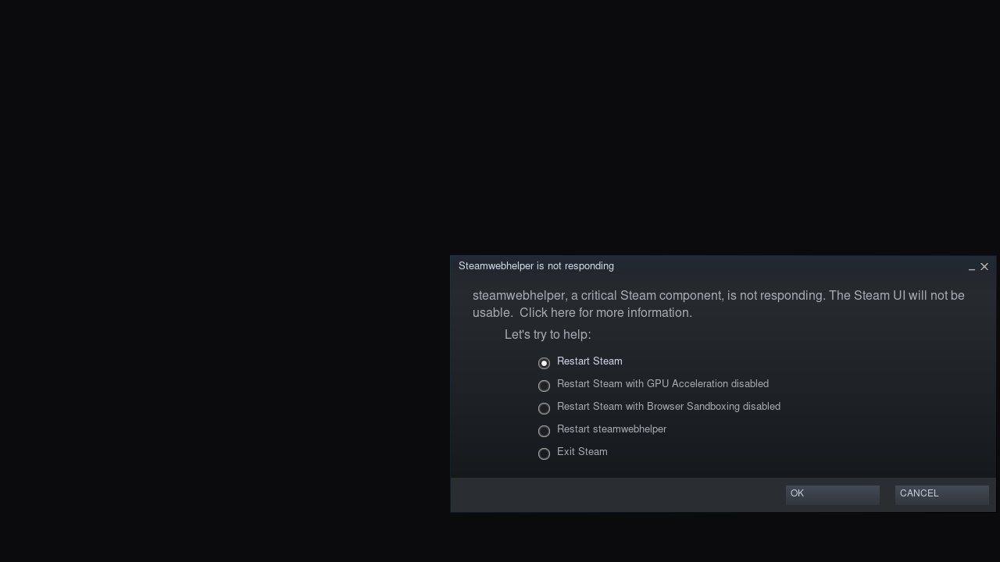

# Test results

Every row says where and when it ran. "Not run" means exactly that. No result
here comes from an iPad yet.

## Session 1: 2026-11-11, Windows 11 development PC (Intel i5-14600K), no Mac, no iPad

### Verified here

| What | Result | How |
|---|---|---|
| Core unit tests (native Windows x86-64, Zig clang 19) | **32 tests, 327 checks, 0 failures** | `python tools/build_core.py test` |
| Bugs the tests caught and that were fixed | QMP negotiation id collided with a command queued before the greeting. The journal demoted running steps on every load (broke the C API between calls). | tests in `core/tests/test_vm.cpp` |
| Guest agent unit tests (Windows) | **3 tests, 11 checks, 0 failures** (the uinput mapping test only compiles for Linux; CI runs it on arm64 Linux) | `python tools/build_core.py agent` |
| Cross-compile for the guest | `ideck-agent` (733 KB), `ideck-bench`, core and agent tests: aarch64-linux-musl and x86_64-linux-musl, **no warnings with `-Werror`** | `build_core.py all --target aarch64-linux-musl` |
| Python tests | **11 run, 0 failures, 2 skipped** on Windows (the POSIX symlink/exec-bit install test runs in CI) | `python -m unittest discover -s guest/tests` |
| Steam bootstrapper against Valve's live data | Parsed the real `steam_client_linuxarm64` manifest (version 1792618285); selected `steam_linuxarm64` and `bins_linuxarm64_linuxarm64` | `RealManifestFormatTests` with `IDECK_STEAM_MANIFEST` |
| ARM64 Steam client packages | Downloaded `steam_linuxarm64` (4,552,071 B) and `bins_linuxarm64_linuxarm64` (110,383,070 B); **both SHA-256 matched the manifest**; `steamrtarm64/steam` is ELF AArch64; zip entries carry no exec bits (so the bootstrapper restores them) | curl, sha256sum, Python zipfile |
| Core C API through ctypes (the path the CI boot test uses) | Built the exact desktop-test QEMU command line; `memory.plan` on 12 GiB / 6 GiB limit → **3072 MiB guest, 384 MiB TB cache**; controller packet encoding correct | `ideck_core.dll` + `tools/ideck_host.py` classes |
| Shell scripts | `bash -n` clean for all 10 scripts | Git Bash |
| Python files | `py_compile` clean | |
| Native benchmark baseline (Windows x86-64, not iPad) | int 2344 Mops/s · fp 9692 MFLOP/s · 20-thread int 16110 Mops/s (6.87×) · memcpy 4590 MB/s · read 8710 MB/s · latency 106.7 ns · ipc 9.67 Gops/s | `ideck-bench.exe` |

### Written but not compiled or run here

| Component | Why not | Where it gets verified |
|---|---|---|
| iOS app (Swift, Objective-C, XcodeGen project) | needs Xcode / the iOS SDK | `ios.yml` on a macOS runner |
| UTM sysroot fetch/build | needs macOS | `ios.yml` |
| Linux image (`linux/build-image.sh`) | needs root on arm64 Linux | `runtime.yml` on `ubuntu-24.04-arm` |
| Boot test: agent ready, virtual controller, provisioning, Steam install, benchmark in the guest, screenshots | needs the image | `runtime.yml` |
| Steam client actually starting in the guest | needs the boot test, then a device | `runtime.yml` screenshots, then iPad |
| JIT with StikDebug, Venus over MoltenVK, SPICE display, audio, controllers on iPad | needs an iPad | device |
| Any game | needs all of the above | device |

## Session 2: 2026-11-11, GitHub Actions (repo `ahmedps520-svg/iDeck`)

### CI (`ci.yml`, commit `cbcae63`): all 8 jobs green

Core and agent tests on Windows 2025, Ubuntu 24.04 x64, Ubuntu 24.04 arm64
and macOS 15; core built with AppleClang/CMake; arm64 test binaries and
`ideck-bench --quick` run under qemu-user; shellcheck and `py_compile` lint.
On arm64 Linux this includes the uinput mapping test and the POSIX
end-to-end Steam bootstrap test that are skipped on Windows.

### Linux runtime 0.1.1 boot test (`runtime.yml` run 42999579844, `ubuntu-24.04-arm`, QEMU 8.2 TCG, `-cpu neoverse-n1`, 4 vCPU, 4 GiB)

Not an iPad: this is the same image and agent protocol under TCG on a GitHub
arm64 server core, with no GPU passthrough (`desktop-test` profile).

| Check | Result |
|---|---|
| Image build (mmdebstrap Debian 13 + backports Mesa 26.1.6, kernel 6.12.116) | ✓ about 75 s |
| Boot to agent `ready` | ✓ **34.4 s** |
| Virtual controller from a host packet | ✓ `Microsoft X-Box 360 pad (iDeck 1)` appeared in `/proc/bus/input/devices` |
| Provisioning: Steam ARM64 client bootstrap | ✓ 2 packages, manifest 1792618285, `steamrtarm64/steam` installed |
| Provisioning: FEX RootFS | ✓ Ubuntu 24.04 EroFS downloaded, hash-checked, mounted at `/usr/share/guestos/fex-mesa` |
| Self-test | 14/16. **Failed: opengl and vulkan → llvmpipe** (expected, because the CI profile has no virgl/Venus). Passed: 4 KiB pages, LSE, LRCPC, library disk (ext4 formatted on first boot), DNS, DRM render node, uinput, agent, Steam binary, FEX RootFS, user namespaces |
| Audio | reported "ok" with sink `auto_null`, which is PipeWire's dummy sink (the CI profile has no sound device). The self-test was then fixed to fail on `auto_null`. |
| Steam service | ✓ `ideck-steam` active with Steam processes; the PIDs changed during the run (a self-update restart) |
| Steam window | **not seen** within about 6 minutes of screenshots (the X session background only). The next boot test waits up to 60 minutes and saves Steam's journal. |
| Clean shutdown via agent | ✓ QEMU exit 0 |

Guest CPU benchmark (`ideck-bench`, inside the TCG guest on the runner):

| Benchmark | Result |
|---|---|
| int_single | 2698 Mops/s |
| fp_single | 220 MFLOP/s |
| int_multi (4 vCPU) | 10171 Mops/s (3.77×) |
| mem_bandwidth (memcpy) | 366 MB/s |
| mem_read | 3702 MB/s |
| mem_latency | 523 ns |
| syscall | 25.4 µs |
| ipc | 2.16 Gops/s |
| jit_translate | 14.1 µs per block (warm 0.37 µs) |

What this tells us: integer code translates well. Floating point, memcpy and
syscalls are the TCG bottlenecks (soft-float helpers, byte-wise memory
helpers, full exception round trips). The iPad's M5 will have different
absolute numbers.

### Linux runtime 0.1.2 boot test (run 43004292541): Steam UI did not load

Boot 34.8 s; provisioning, controller, benchmark and shutdown as for 0.1.1.
The new 60-minute Steam-window wait and the saved journal showed the client
**crashing in a loop (296 restarts)**:

```
dlmopen steamui.so failed: libgtk-x11-2.0.so.0: cannot open shared object file
Fatal error: Failed to load steamui.so
```

The updater, manifest check and download hosts all worked under TCG. Two
causes, fixed for 0.1.3:

1. **Missing system libraries.** The `DT_NEEDED` entries of every ELF in the real `bins_linuxarm64_linuxarm64` package were parsed. Added to `linux/packages.txt`: GTK2 (`libgtk2.0-0t64`), OpenAL, libnm, SDL2, libavif, ICE/SM, fontconfig, freetype, libsndfile, libasyncns, libssh2, brotli, OpenSSL 3, libX11-xcb, libpipewire and the X extensions.
2. **Minimal install never completed.** With only the 2 core packages, the client reported "installed version == manifest version … Nothing to do" and never fetched CEF (`libcef.so`), SDL3 or the codecs. The bootstrapper now installs the full set by default (34 packages, 996 MB), and `--check` requires a recorded full install.

A new self-test check (`steam-libs`) runs `ldd` on the client's main binaries
and names any library that does not resolve.

### First device run (iPad17,2 = M5 iPad Pro, iPadOS 27.2, build 9)

| Finding | Fix |
|---|---|
| QEMU exited 36 ms after start: `Property 'virtio-gpu-gl-pci.refresh_rate' not found` | removed the property (build 10) |
| App memory limit measured at **5120 MiB** (5110 MiB available at launch), so the planner chose a 2 GiB guest | planner retuned: 3 GiB at this limit (build 10) |
| `CS_DEBUGGED` true but `P_TRACED` false: StikDebug attached and detached at once (no script assigned to an unknown app) | in-app JIT request with `script-name=legacy.js`, and P_TRACED required on iPadOS 26+ (build 11) |

### Device run, build 15 (iPad17,2, iPadOS 27.2, runtime 0.1.1)

Measured from `ideck.log`, `qemu.log` and `console.log` shared from the device:

- JIT through StikDebug legacy.js: `CS_DEBUGGED` true, `traced` true.
- Linux reached the guest agent **10 s** after QEMU started (guest 3072 MiB, 4 vCPU, TB cache 384 MiB).
- In-guest setup: `install-steam` done (the 0.1.1 minimal client), `install-compat` done (FEX RootFS downloaded, verified and mounted).
- `init-graphics` failed. Every Venus blob creation failed: `virtio_gpu_virgl_process_cmd: ctrl 0x10c, error 0x1200` (RESOURCE_CREATE_BLOB → ERR_UNSPEC), followed by MAP/UNMAP_BLOB and UNREF failing for the missing resource. This happened once per provisioning attempt.
- iPadOS terminated iDeck about 75 s into setup. `crash.log` was empty, so no signal reached the app, which points to a memory kill. The trace showed the app footprint climbing steadily while the guest itself reported only 133–386 MiB used:

  | Time | Footprint | Available |
  |---|---|---|
  | 12:39:21 | 857 MiB | 4262 MiB |
  | 12:40:01 | 2282 MiB | 2837 MiB |
  | 12:40:31 | 3228 MiB | 1891 MiB |

  The growth matches guest RAM being touched by page cache during the Steam and FEX downloads. Guest RAM is anonymous memory, so all of it is charged to the app. The installer's `provision.retry` then restarted provisioning twice, re-running the GPU probes each time.

| Finding | Fix (build 16) |
|---|---|
| Guest page cache charged to the app footprint | guest RAM in a shared file mapping in Caches (`memory-backend-file,share=on`), on by default; no balloon in that mode (QEMU cannot discard file-backed RAM on Darwin) |
| Venus blob memory: UTM's virglrenderer uses `shm_open("<app group>/<hex>")`, which the sandbox allows only for an app group in the code signature | at launch, read the signed entitlements (csops) and probe shm under each candidate group; Vulkan is turned off for the session when none works (OpenGL is unaffected) and the reason is logged |
| A failed graphics check stopped setup and triggered retries | `vulkan` is an optional check; a step with only optional failures ends as `warning` and setup continues; the automatic retry is only for the download steps; step details are logged |
| The device stayed on runtime 0.1.1 | the newer-runtime check now runs until setup completes, not only before the first boot |

### Linux runtime 0.1.3 boot test (run 43015376314): Steam install failed on layout

- Boot to agent in 34 s.
- FEX RootFS mounted (Ubuntu 24.04 EroFS).
- `steam-libs`: "all client libraries resolve", so the 0.1.2 GTK gap is closed.
- The full Steam install (34 packages, 996 MB) extracted every package, then failed with `/home/deck/.local/share/Steam/steamrt64 exists and is a directory`. Checked from the published zips:
  - `steam_steamrt_linuxarm64` ships `steamrt64/steam` as an x86-64 ELF (`e_machine` 0x3e).
  - `bins_steamrt_linuxarm64` puts x86-64 client libraries in `steamrt64/` and x86 ones in `steamrt32/`.
  - The bootstrap's `steamrt64 → steamrtarm64` link collided with that real directory.
- `ideck-steam.service` then re-ran the whole install on every restart: 14 restarts, about 4 min CPU and a 2.4 GB memory peak each.
- `steam_window_seen` was false.
- GL, Vulkan (llvmpipe) and audio (`auto_null`) failed as expected on a CI runner with no GPU or sound device.

### Device run, build 16 (iPad17,2, iPadOS 27.2, runtime 0.1.1 → 0.1.2)

- The code signature has **no app group** (`app groups []`; the group in the logs came from the Info.plist fallback). `shm_open("group.com.ideck.app/…")` failed with EPERM, so Vulkan was turned off for the session as designed.
- Guest RAM was file-backed. The footprint was 610 MiB after QEMU start (857 MiB in build 15) and 1002 MiB with the guest at 514 MiB used. No memory termination in this session.
- OpenGL: `virgl`, OpenGL 2.1, Mesa 26.1.6.
- Runtime 0.1.2 still treats Vulkan as required, so `init-graphics` failed and setup stopped. The guest-side change ships in the runtime, not in the app.
- In the session before that, iDeck was launched with JIT attached, then spent 52 s installing runtime 0.1.2 before starting QEMU. It died with SIGTRAP in `tcg_region_init`: QEMU's `brk #0x69` JIT request was never answered. Boots 1–6 s after StikDebug attached worked.

| Finding | Fix (runtime 0.1.4, build 17) |
|---|---|
| `steamrt64` layout collision; a full install over the old link would mix x86-64 files into `steamrtarm64/` | no link and no `.steam-enable-steamrt64-client` flag; an old link is removed together with `steamrtarm64/`, which is reinstalled; extraction refuses to write through symlinks; a complete install requires an AArch64 `steamrtarm64/steam` |
| Install restarted from scratch on every service restart | a retry keeps the packages already extracted; `ideck-steam.service` waits 20 s between restarts and stops after 4 starts in 15 min |
| JIT request unanswered after a long gap | QEMU is not started when the debugger attached more than 45 s earlier; iDeck asks for a relaunch with JIT instead of crashing |

### Linux runtime 0.1.4 boot test (run 43061237530): the Steam client starts

QEMU 8.2 TCG on `ubuntu-24.04-arm`, no GPU and no sound device.

**Setup and launch**
- Boot to the agent took 34 s.
- `install-steam`: "installed 34 packages" (client version `1792618285`, full set), with no layout error. `install-compat`: FEX RootFS mounted. Provisioning finished at 498 s.
- `ideck-steam.service` started `steamrtarm64/steam` (native ARM64), which ran "Verifying installation…".
- `steam_window_seen: true`, for the first time. `screen-01.png` shows the client's own native dialog:

  

**Problems seen**
- The Steam UI did not load. `steamwebhelper` (CEF) logged `Failed creating offscreen shared JS context`, and the client showed "Steamwebhelper is not responding" with its own recovery options. Not yet separated: slowness (TCG with llvmpipe on a CI runner) versus a real CEF problem. The next things to try are the software-UI switch (`-cef-disable-gpu`) and the device's JIT speed.
- The client then started its self-update (667,975 KB): it reported "Package file … missing or incorrect size" for its `package/*.zip.vz.*` cache, which the bootstrap does not keep. At 800 s the main process died with SIGBUS (`status=7/BUS`). The service restarted it 20 s later, and the update resumed (312,428 KB left) when the test ended.
- The client wrote crash dumps and uploaded them to Valve's crash reporter (`CrashID=bp-…`). That is Steam's own behaviour, not iDeck's.
- GL and Vulkan (llvmpipe) and audio (`auto_null`) failed as expected on the runner.

### Device run, build 17 with runtime 0.1.4 (iPad17,2, iPadOS 27.2)

- Reported by the user: setup finished without iDeck closing.
- "Resume Steam" showed a black screen with no mouse pointer. Guest CPU stayed at 8–11%, so Steam was not busy updating.
- `qemu.log`: all SPICE channels opened (main, display, cursor, inputs, playback). No virtio-gpu or GL errors.
- `console.log`: `ideck-session.service` (Xorg) and the deck user session started.
- Nothing in the app recorded the display client's state: no object was registered for its events, so `ideck.log` had no display lines.
- Build 18 adds display diagnostics:
  - display events in the log;
  - a state line (channel, size, frame texture, renderer and view);
  - `display.png`, the last frame received from Linux, included in Share logs;
  - CocoaSpice and spice-gtk debug output for the first two minutes.

Build 18 on the device, from `qemu.log` with SPICE debug on:
- The GPU display path works:
  - First scanout 640x480 (boot console). The user saw the Linux boot text on the iPad.
  - Then Xorg switched the output to 1280x720. CocoaSpice took the new scanouts (one stale fd ignored, as designed) and kept receiving `gl draw 1280x720` updates.
- No pointer, by design so far: `ideck-session.service` starts Xorg with `-nocursor`, and the cursor channel only ever got `set_cursor: flags 1, size 0`.
- The desktop background is `#0b0b0d`. The black screen therefore fits Linux showing an empty desktop with no Steam window. Steam's state is not visible from the app logs.
- Mouse mode switched to client (absolute) once the guest SPICE agent connected.

Build 19 saves the Steam, X session and provisioning journals from Linux (`linux-*.log`) for Share logs, and logs Steam's service state.

### Device run, build 19 with runtime 0.1.4: the Steam client runs on the iPad

From `linux-steam.log`, `ideck.log` and `display.png`:

**Startup**
- Linux took 9 s to the agent. Provisioning took the cached fast path: setup `done`, with graphics and self-test as `warning` (Vulkan llvmpipe only; OpenGL `virgl`, 2.1).
- `steamrtarm64/steam` started 15 s after boot. Its updater checked `steam_client_linuxarm64`: "installed version 1792618285 … Nothing to do". Verification skipped.
- The client reached its UI start: `steamsysinfo` GPU topology (llvmpipe, since Venus is off) and `steamwebhelper` launch. `ideck.log`: `steam: service active, 9 Steam processes`.
- Guest CPU dropped to 0–5% within a minute.

**Problems**
- `steam-runtime-launcher-service: not found`, `steamrtarm32/gldriverquery: not found` and `lspci: not found` once, then `lsof: not found` every few seconds.
- An assert minidump was uploaded by the client, and Valve's server discarded it.
- `display.png`, the frame CocoaSpice received:
  - It shows the desktop with several unpainted light-grey windows stacked at the lower right: Steam's windows, opened but not drawn by `steamwebhelper` (CEF).
  - The PNG is lighter than the real screen: CIImage treats the texture as linear, so the `#0b0b0d` background comes out about `#3c3b40`.

  

- The app's view went black although frames had arrived. `IDSpiceClient` keeps one attached view, and `DisplayViewController.deinit` called `detachFromView()` unconditionally. A controller that SwiftUI tore down after its replacement had attached took the display away from the new view. A re-attached view also kept the renderer's 1:1 scale (`scale 1.000` in the log) until the display size next changed.

| Finding | Fix |
|---|---|
| Old view controller detached the new view | `detach(from:)` only detaches the given view; the view re-attaches in `viewDidAppear`; viewport is recomputed after layout (build 20) |
| No pointer | Xorg no longer runs with `-nocursor`; `xsetroot -cursor_name left_ptr` (runtime 0.1.5) |
| `lsof` / `lspci` missing | `lsof` and `pciutils` added to the image (runtime 0.1.5) |
| Steam windows unpainted | not fixed yet; next test is Settings › Software-rendered Steam UI (`-cef-disable-gpu -cef-disable-gpu-compositing`) |

### Device run, build 21 with runtime 0.1.5: Steam UI usable (user report)

Reported by the user, 2026-11-11; no screenshot or logs from this session yet:
- "ITS WORKING WE ARE IN STEAM": the Steam client UI rendered on the iPad. Settings › Software-rendered Steam UI was on, so CEF ran without GPU (`-cef-disable-gpu -cef-disable-gpu-compositing`), and build 21 restarted Steam for the option to apply.
- The UI was "very laggy and heavy" with no game open.
- Scrolling did not work. In builds up to 21, one-finger drag only moved the pointer, and two-finger drag sent wheel steps derived from finger velocity.
- Supermarket Simulator (a Windows game) installed. Pressing Play showed "Running" but no game window appeared. That path runs Proton (x86-64) under FEX inside TCG, and DXVK on Vulkan llvmpipe, because Venus is off without an app group. Logs from the launch are still needed.

Build 22: one-finger drag scrolls (wheel notches by finger distance), two-finger and trackpad scrolling use the same distance-based mapping, and trackpad click-drag is a left-button drag. Runtime 0.1.7:
- adds Lightweight Steam (`-nofriendsui -nochatui`, on by default);
- makes the agent queue Steam start, stop and restart without blocking.

### CI, Linux runtime 0.1.6 software-UI boot test (run 43081858902): inconclusive

Steam was started with `-cef-disable-gpu -cef-disable-gpu-compositing`
(`--steam-software-ui`), the app's Software-rendered Steam UI path.
- The client started, but `steamwebhelper` restarted about every 10 s.
- The client logged `Failed creating offscreen shared JS context`, wrote assert dumps, and exited with SIGBUS three times. systemd then stopped retrying.
- Every screenshot was blank (4319-byte PNGs).

The same mode shows a working Steam window on the iPad (build 21, above). In
the CI VM (no virgl, llvmpipe only) the Steam UI has never loaded in any mode:
the GPU-mode tests (0.1.4, 0.1.8) only reach Steam's own "Steamwebhelper is
not responding" dialog. This result says nothing about the device.

### Vulkan without app groups (build 24, CI only)

Problem: Sideloadly free-account signing carries no app group, so
virglrenderer's `shm_open("<group>/<hex>")` fails with EPERM and every Venus
blob failed. Builds 16–22 therefore turned Vulkan off.

Build 24 serves those calls from unlinked files in `tmp/ideck-gpu`
(`ios/iDeck/Native/IDSharedMemoryFallback.c`):
- the `shm_open`/`shm_unlink` import slots of the embedded frameworks are pointed at a stand-in;
- the stand-in tries the real call first.

Evidence so far:
- **Static check of the build 22 IPA** (Mach-O indirect symbol tables, `shm_imports.py`): `virglrenderer.1`, `qemu-aarch64-softmmu` and `spice-server.1` import `_shm_open` and `_shm_unlink` through `__DATA_CONST,__got`. All are arm64 (not arm64e) with chained fixups, which is the layout the stand-in rewrites.
- **CI `shm-fallback` job (macos-15, commit `f5b47b4`): PASS in both modes.** A test library repeats anon_file.c's sequence (named `shm_open` with O_EXCL retry, `shm_unlink`, `ftruncate`, two `MAP_SHARED` mappings) at 16 KiB, 1 MiB and 64 MiB, plus the EEXIST case.
  - Plain run: 1 image and 2 slots redirected; 5 of 6 calls answered with files; no file left behind.
  - Under `sandbox-exec` with `(deny ipc-posix-shm*)`: the real `shm_open` fails with "Operation not permitted", as on the iPad. All allocations still succeed through files.
- **On device**, not yet run. At launch the app repeats the sequence and has Metal wrap the file mapping (`newBufferWithBytesNoCopy`, as MoltenVK does for imported host memory), copy it and write into it. The `signature:` log line then reads `GPU shared memory file-backed fallback (...)` and `vm:` shows `vulkan true`. Whether Venus then gives the guest a working Vulkan device is the open question for the next device run (Runtime › Self-test `vulkan` check).

### iPhone and 8 GB devices (build 24, CI only)

- Core tests: 35 tests, 344 checks, 0 failures. New cases:
  - 8 GB device (7680 MiB, 3400 MiB limit): a 3 GiB guest fits only with file-backed guest RAM;
  - 12 GB device with the measured 5120 MiB limit: 4 GiB.
- Not run on an iPhone or an iPad Air yet.

**Build 24 IPA** (`ios.yml` run 43109479420, commit `ca3ca06`, 19.0 MB):
- `UIDeviceFamily` [1, 2] (iPhone and iPad); all 34 needed frameworks are embedded.
- The app binary contains the fallback's strings (`ideck-selftest/%x`, `ideck-metal/%x`) and imports `_dyld_register_func_for_add_image`.
- The three frameworks still import `_shm_open` through `__DATA_CONST,__got`.

### Linux runtime 0.1.8 boot test (run 43109484177): published; Steam UI as in 0.1.4

- Boot 32.3 s. Provisioning ran and the runtime was published as `runtime-0.1.8` (system.img.xz 329,766,164 bytes).
- Steam started with the Lightweight flags: `-noverifyfiles -nofriendsui -nochatui -no-cef-sandbox`.
- At 676 s the first non-blank screen showed Steam's "Steamwebhelper is not responding" dialog. It is byte-identical to the 0.1.4 screenshot, so the CI result has neither improved nor regressed. The UI still does not load in the CI VM.
- zram swap is not created here: the CI guest has 4 GiB, above the 3.5 GiB threshold.

### Device run, build 23 with runtime 0.1.8: sessions end while Steam updates (2026-11-12)

The user reported "It crashed" and shared logs from iPad17,2, iPadOS 27.2.

- **The app was build 23, not 24.** The launch line has no `RAM … cores …` fields (added in build 24). The signature line says "GPU shared memory unavailable" instead of the build 24 file fallback, and the log has `vulkan: off`. The Venus file fallback is therefore still untested on a device.
- Runtime 0.1.8 was active: Steam ran with `-noverifyfiles -nofriendsui -nochatui -no-cef-sandbox`, and the provisioning, zram and self-test steps ran. Self-test passed 16/17; the failing check was Vulkan on llvmpipe, as expected with Vulkan off.
- **Valve published a Steam client update** (installed 1792618285 → 1794424036). Steam downloaded 574,010 KB in about 27 s, then logged "Installing update… Extracting package…". In the CI journal (runtime 0.1.6) the same stage took about 6.5 min under emulation:
  - extracting: 4 min 48 s;
  - installing to cleaning up: 1 min 42 s;
  - then "Update complete, launching Steam…".

  During that time only the small updater window is on screen.
- Three app sessions within four minutes, all launched with JIT (`traced true`). The exact moments the first two ended are not in the logs.
  - **A**, about 04:07: its saved Linux journals end in "Extracting package…" at 04:08:08. The session ended before 04:09:50.
  - **B**, 04:09:50: the last line is at 04:10:29, 37 s after boot started. Footprint was flat at 971–981 MiB with 4.1 GiB of headroom, and memory pressure was "normal".
  - **C**, 04:10:41: still running when the logs were shared. Steam logged "didn't shutdown cleanly" and the update started again.
- `crash.log` had only one entry, from 2026-11-11 13:12 UTC: SIGTRAP in `tcg_region_init`, the unanswered JIT request seen in build 16. Sessions A and B therefore did not end with a signal that the handler sees. That leaves SIGKILL: an iOS memory or watchdog kill, the app switcher, or StikDebug launching iDeck again. The logs cannot tell these apart, because build 23 recorded no app lifecycle, memory-pressure or debugger state.
- The shared `linux-*.log` files came from session A, not from the session in `ideck.log`. The first journal capture was at 60 s, so B never saved its own.
- `display.png` (session C) shows the Steam updater window with grey, unpainted Steam windows around it.

| Finding | Change (build 26) |
|---|---|
| No record of why a session ended | Linux sessions are recorded in `linux-session.json`. At the next launch iDeck logs `previous session: … ended without a crash signal` (or the crash signal), with the last app state. The home screen shows a notice explaining it |
| No lifecycle, pressure or debugger state in the trace | `app: active / inactive / background / foreground / memory-warning / thermal / terminating` lines; `memory pressure from iOS: …` and pressure actions are logged; the 10 s `mem:` line adds `traced`, thermal state and free disk space |
| Leaving the app froze Linux mid-write | On entering the background iDeck takes a background task, runs `fs.sync` in Linux and saves the journals before iOS suspends it |
| Journals from an earlier session were shared | First capture 20 s after the agent is ready, then every 30 s. Each file starts with a `# captured … by iDeck pid …, Linux up since …` header |
| The Steam update looked like a hang | iDeck reads Steam's journal and shows "Steam is downloading a client update: X of Y MB" or "…installing…" over the display (every 6 s while it runs) |
| `StorageManager.decide()` (iOS "important usage" free-space query) ran on the main thread on every 2 s metrics event | Runs off the main thread, at most every 30 s |

Build 26 checks:

- **Build 25 (`ab23159`) failed to compile.** A string literal in `LogParsers.swift` contained a raw line break, and the new CI job caught the same error.
- **Build 26 (`2648d19`, run 43155401363)** produced an IPA of 19,073,733 bytes with CFBundleVersion 26, `UIDeviceFamily` [1, 2] and no `UIBackgroundModes`.
  - The new log strings are present in the binary.
  - All `@rpath` dependencies resolve (37 frameworks embedded, 34 needed).
- **CI `log-parsers` (run 43155390530):** 17 of 17 checks passed. These cover download progress with thousands separators, each stage through to "Verification skipped", and crash.log and trace parsing.

Not run on a device yet:

- the new behaviour;
- what actually ends sessions there (**not yet known**).

### Linux runtime 0.1.9 and builds 27–29 (CI, 2026-11-12 to 2026-11-22)

All of this was measured on GitHub `ubuntu-24.04-arm` runners under Ubuntu's QEMU 8.2 TCG (4 vCPU, 4 GiB, `neoverse-n1`). None of it has been run on a device yet.

**1. Kernel page-table isolation (`kpti=0`).** The A/B benchmark ran in each of the runtime runs below (43218566550, 43223248641, 43577647630, 44962279654). The kernel command lines were identical apart from `kpti=0`.

| Run | KPTI on: syscall / mem latency / memcpy | `kpti=0`: syscall / mem latency / memcpy | Boot to agent (on → off) |
|---|---|---|---|
| 43218566550 | 20,689 ns / 426 ns / 388 MB/s | 2,907 ns / 206 ns / 1,106 MB/s | 33.2 → 21.8 s |
| 43223248641 | 20,282 ns / 423 ns / 363 MB/s | 2,904 ns / 216 ns / 1,013 MB/s | 32.7 → 22.0 s |
| 44962279654 | 21,296 ns / 424 ns / 355 MB/s | 2,865 ns / 219 ns / 997 MB/s | 33.3 → 21.6 s |

The kernel's own messages, reported by the agent:
- without `kpti=0`: `CPU features: kernel page table isolation forced ON by KASLR`;
- with it: `… forced OFF by kpti command line option`.

**2. Steam's package files and installed version.**

| Run | Bootstrap wrote | Steam's first start | After a Steam restart |
|---|---|---|---|
| 0.1.8 device log (2026-11-12) | nothing kept | "Package file … missing" for all 34 packages; 574,010 KB download, then extract | — |
| 43218566550 | VZ copies in `package/` | 0 missing, 0 downloads; "installed version 0", "uninstalled manifest found" | not tested |
| 43223248641 | + manifest copy as `.installed` | same: "installed version 0" | not tested |
| 43577647630 | same | same | Steam restarted and installed itself: extract 2 min 43 s, then install 44 s. Afterwards `package/` held `steam_client_linuxarm64.manifest` (the manifest, 12,393 bytes) and a 1,550,574-byte `.installed`, and all 34 archives (684,921,978 bytes) were still there. |
| 44962279654 | VZ copies + `steam_client_linuxarm64.manifest` | **"Download skipped: … version 1794536281, installed version 1794536281"**, "Nothing to do" | **Same "Download skipped", no install** |

**3. Steam's UI while away** (run 44962279654, build 29's `steam-ui-daemon`, Steam sign-in window):
- Guest CPU, 60 s average across 4 vCPUs:
  - window shown: 22.5%;
  - `away` (1 window minimised, 7 `steamwebhelper` processes at nice 19): 13.5%;
  - shown again: 18.5%.
- Screenshots: the `away` frame is the empty desktop (4,319 bytes). The `visible` frame shows the sign-in window again (34,414 bytes).
- Only the sign-in screen can be measured in CI, since there is no Steam account. On the library page, which animates and loads images, the saving is expected to be larger, but that is not measured.

**Other results.**
- Steam's real UI appeared in every 0.1.9 run, about 2.5 min after Steam started. 0.1.8 showed only "Steamwebhelper is not responding".
- The whole boot test now takes 12 to 25 min, against 1 to 3 hours before.

**Published:** runtime 0.1.9 (run 44965400192, 2026-11-22). The image was rebuilt from the boot-tested commit `6d37c18` with the boot test skipped, so its Debian packages were fetched again on that day. `system.img.xz` is 329,889,656 bytes. `runtime-latest/manifest.json` now names 0.1.9.

**App builds:**
- **Build 27** (run 43217211098): IPA compiled.
- **Build 28** (run 43218571816): 19,079,908 bytes, CFBundleVersion 28; 37 frameworks embedded, none missing; `kpti=0`, the signing-profile and memory-check strings present. Sent to the user on 2026-11-14.
- **Build 29** (run 44962282335): 19,085,630 bytes, CFBundleVersion 29, `UIDeviceFamily` [1, 2]; none missing; the Steam-UI strings present.

**CI checks (runs 43218534695, 43223248162, 43577647716, 44962279257):** every job passed, including:
- the CI test that decodes a real VZ package from Valve's CDN and compares it file by file with the plain zip;
- shellcheck of `steam-ui-daemon`;
- the signing-profile parser checks.

### Build 30: SideStore/AltStore update feed (CI and this PC, 2026-11-22)

`ios.yml` run 45011924870 (commit 0703c75). Both jobs passed: `sideload`, and `publish`, which releases the build and updates the feed.

**IPAs** (release `ios-build-30`):
- `iDeck.ipa`: 19,085,649 bytes, unsigned (no entitlements), for Sideloadly.
- `iDeck-SideStore.ipa`: 19,123,895 bytes, SHA-256 `048b52a0…70007787`. `ldid -e` shows the four entitlements of `iDeck-SideStore.entitlements`, including the app group `group.ideck`.
- Both IPAs: CFBundleShortVersionString `0.1.30` (builds up to 29 were `0.1.0`), CFBundleVersion `30`.
- Both contain the same 198 files. Only the main executable differs. The dependency check finds nothing missing in either.

**Feed** (`ios-feed/source.json`):
- The publish job wrote it from the IPA (no earlier feed existed).
- It then downloaded the feed and the IPA again, as SideStore does, and checked them against each other: version, build, size, SHA-256, four entitlements and two privacy keys all matched.
- The same check (`--verify-url`, `--expect-version 0.1.30`) passed from this PC through GitHub's 302 redirect. The icon downloaded (36,105 bytes).

**Tests:** `tools/tests` ran 20 tests, all passed, on Windows and in CI's lint job (CI run 45011924360, every job passed). They use synthetic signed thin and fat Mach-Os and a local web server that redirects like GitHub.

**Not tried yet on a device:**
- adding the feed and installing from it in SideStore;
- whether SideStore registers `group.ideck.<team ID>` and Venus then uses real shared memory;
- an update from build 30 to 31.

### Device run, build 30 with runtime 0.1.9 (iPad17,2, iPadOS 27.2, paid Apple ID via iloader, 2026-11-22)

Installed with iloader 2.4.2 (Import IPA), together with StikDebug 3.2.2 and SideStore. The logs were copied from the iPad with Apple Devices (Files › iDeck › Logs).

- **Signing:** profile valid until 2027-11-22 (long-lived); increased-memory-limit true; extended-virtual-addressing false. App ID `com.ideck.app.<team ID>`.
- **Boot:** limit 12288 MiB → guest 4096 MiB, TCG cache 384 MiB, 6 vCPUs, Vulkan on with file-backed blob memory. The agent was ready 7 s after QEMU started, with KPTI forced off by the command-line option.
- **User report:** "very very slow". Steam showed its library, signed in. Guest CPU was 60–80% of 6 vCPUs while Steam loaded; footprint about 1.1 GB.
- **Vulkan:** no device in Linux (self-test 16/17). `qemu.log` repeats `APP_SANDBOX_GROUP_ID is 30 chars, at most 28 fit`, followed by failing blob commands. Fixed in build 31.
- **Steam crash:** the main process got SIGSEGV after 155 s; systemd restarted it 20 s later. No cause in the journal.
- Details and what changed: [PERFORMANCE](PERFORMANCE.md#device-run-build-30-ipad172-ipados-272-paid-apple-id-2026-11-22).

### CI, 2026-11-22: Steam UI pinning and TCG cache size

Runtime 0.1.10 candidate (commit 94cc92b), `runtime.yml` boot tests with Steam's sign-in window:
- **Pinning:** Steam's web helper ran on CPUs 2-3 pinned and 0-3 with the `steam-path` taskset (agent `top`). The window after a restart took 90.7 s pinned and 79.0 s unpinned (GPU mode, run 45019076683), and 66.6 s against 66.5 s (software UI, run 45019070085).
- **Cache flushes:** 384 MiB 19 / 35, 1024 MiB 5 / 9, 2048 MiB 2 / 4 (by the window / about 10 min later; runs 45019070085, 45023348581, 45023361147).
- `tools/tests` (24 tests) and the agent's `/proc` parsing test passed.

### CI, 2026-11-23: runtime 0.1.11 candidates (software Steam UI, 1 GiB TCG cache)

- **Steam UI in the agent** (run 45183440240, commit 2ba8b88):
  - `steam-ui-daemon` is gone, and the states still work: the away screenshot is blank (4,319 bytes) and the window is back at 38 KB.
  - Guest CPU on the sign-in screen was 6.3% shown, 7.3% hidden, 6.3% shown again (runtime 0.1.10: 11.6, 9.6, 10.3).
  - TCG cache flushes: 4 by the window, 7 in total.
- **Lean Chromium options:** no gain. 60.5 s against 60.6 s to the window, 7 against 8 processes, 1534 against 1450 MB. Removed again.
- **CPU model, `--bench-only`** (run 45183440240):
  - `mem_copy_glibc` (new): n1 2,698, max 3,843, n1 again 2,732 MB/s.
  - Other results within noise.
- **Full boot tests, n1 against max** (runs 45190915383, 45190934622):
  - On both, Steam's window appeared (621 s and 650 s after start) and the UI states worked.
  - Benchmark, n1 against max: `mem_copy_glibc` 2,630 / 3,225 MB/s, `fp_single` 181 / 224, `mem_latency` 213 / 184 ns.
  - The app uses `max` from build 34.
- **Disk flushes** (QMP `query-blockstats`, run 45190915383):
  - Library disk: 1,119 flushes taking 19.0 s by Steam's window, including the 5.7 GB Steam install.
  - About 1,400 more in the following 20 minutes of Steam restarts.
  - That is on the CI host's fdatasync; the iPad's F_FULLFSYNC is logged from build 34.
- **Zink, first attempt:** the window never drew. The web helper's GPU process loaded the Vulkan loader and `libvulkan_radeon` but had no device, because CI has no GPU and Zink skips CPU Vulkan devices. The next check runs Zink on lavapipe (`zink-cpu`).
- **Tests:** agent 49 checks; `tools/tests` 25; guest Python 26 (including `steam_prefs.py`); all passed.
- **Final 0.1.11 check** (run 45200353511, `max`, light library on, software UI):
  - Steam's window appeared, the UI states worked, and there was no crash.
  - A restart to the default drew the window in 62.6 s.
  - Zink on lavapipe loaded (`libvulkan_lvp`, `libgallium` in the GPU process), but the window never drew.
- **Zink with kopper** (run 45209949087, runtime 0.1.12 candidate):
  - The window drew correctly in 120.8 s; the browser and GPU processes both ran on Zink over lavapipe.
  - CPU in the following 60 s was 20.6%; a restart back to software drew the window in 72.6 s.
- **Published:** runtime 0.1.11 (run 45209862503, commit 14e21d0), runtime 0.1.12 (Zink kopper fix, commit c805838), and app build 34 (run 45200443080, in the SideStore/AltStore feed).

### Engine patches: native floating point and process switches (CI, 2026-11-23)

iDeck's QEMU from this point is UTM's QEMU 10.0.12 plus `engine/qemu/*.patch`
([CPU_ENGINE](CPU_ENGINE.md)). Nothing in this section ran on an iPad.

**Instruction check and benchmarks** (`engine.yml`, ARM64 runner, Neoverse N2; the
same static binaries on the runner's CPU and in guests with 4 vCPUs):

| Run | What | Result |
|---|---|---|
| 45240386488 | first build of the patch; 186 patterns | registers equal to hardware for all; FPSR differed on 5 (a stray inexact flag) |
| 45242298976 | per-run dumps of those 5 | the flag appears only on the first run of a newly translated block |
| 45243645133 | translator's own FP flags kept out of the guest's | registers and flags equal for all 186 |
| 45245742398 | slot cache (values stay in host registers); 189 patterns, 90,000 mixed-sequence runs | all equal; fp_scalar 14.8 to 35.7 Mpairs/s, fp_convert 35.7 to 115.1, fp_vector 59.1 to 429.3, fp_single 228 to 586 |
| 45251783425 | patch 0002, TLB entries of the kernel kept | all equal; ctx_switch 89.9 to 47.3 us |
| 45253235590 | 0002 also keeps the kernel's jump cache entries | all equal; ctx_switch 99.1 to 28.7 us, ctx_switch_64p 122.0 to 48.8 us |

- The check found a real difference in another emulator: Ubuntu's QEMU 8.2, which
  the boot tests used until now, computes `FJCVTZS` differently from hardware
  (`bench-max`, run 45254513225). QEMU 10.0.12 does not.
- A benchmark bug surfaced the same way: `ctx_switch` hung on the runner's CPU
  (run 45249819016) because the child kept its own copy of a pipe end.

**iOS build of the patched QEMU** (`ios.yml` on the `engine-host-vfp` branch):
- Run 45242404771: QEMU compiled, installed and passed UTM's framework fix-up; the
  script's own check then failed on a `grep -q` under `pipefail`.
- Run 45246869561: passed. QEMU (aarch64-softmmu only) builds in 5 minutes against
  UTM's prebuilt sysroot with UTM's script, compiler and flags; it links the same
  set of libraries as UTM's QEMU (the script compares), with VirGL 1.3.0, SPICE,
  slirp, libusb and usbredir found. PNG support is off in this build (pkg-config
  did not find zlib for libpng); the app does not use it. The IPA packaged.

**Whole image on the patched QEMU** (`runtime.yml`, 4 vCPUs, 4 GiB, `max` CPU
model, software-drawn Steam UI as on the iPad):

| | 45255288785: options off (control) | 45246861541: native FP | 45254513225: native FP + kept TLB |
|---|---:|---:|---:|
| Boot to agent | 21.9 s | 22.8 s | 22.4 s |
| fpcheck in the image, against the build host's CPU | all 189 equal | all 189 equal | all 189 equal |
| Steam installed, client started, sign-in window drawn | yes | yes | yes |
| Sign-in window after a Steam restart | 66.6 s | 60.5 s | 60.5 s |
| Guest CPU with the sign-in window shown / hidden | 10.5% / 8.1% | 10.5% / 7.2% | 8.4% / 6.5% |
| fp_scalar, fp_vector, fp_convert | 13.5, 55.4, 32.3 | 33.5, 398.0, 109.8 | 33.6, 353.0, 88.2 |
| ctx_switch, ctx_switch_64p | 131.0, 157.9 us | (not in this image) | 52.3, 73.6 us |
| Steam through Zink on lavapipe (CI-only GPU-UI check) | sign-in page at 120.8 s | splash at 78.6 s, page later (see below) | splash at 73.0 s, page later |

- Benchmark boots without Steam, same run 45254513225: helpers / native FP /
  native FP + kept TLB: fp_scalar 13.8 / 33.9 / 32.3, fp_vector 55.0 / 353.9 /
  375.5, fp_convert 35.3 / 104.3 / 111.2, ctx_switch 109.6 / 106.4 / 39.3 us.
- The sign-in screen itself gains little: starting Steam is mostly translating new
  code, which these patches do not change.
- **The Zink check looked like a defect and was not.** With the options on, the
  screenshot 20 s after the first drawn frame showed an empty dialog, and the
  control with the options off showed the sign-in page.
  - Eleven diagnostic runs (each option alone, the slot cache off, and eight
    with a different eighth of the patterns left to QEMU; runs 45263772871 to
    45264517426) did not line up with any option: native floating point alone
    drew the page, and three unrelated variants showed the empty dialog. Every
    one of those drew the page 18 to 24 s later.
  - The kept frames explain it. Steam first shows a splash, "Waiting for
    network…" over fading cover art, then an empty dialog, then the sign-in page
    at about 118 s. A faster guest reaches the splash at 72 to 79 s, and the test
    took that for the window; the slower control never caught it. All three
    frames are drawn correctly through Zink with the options on.
  - The test now waits until two frames 5 s apart are both drawn and the same
    size (`steam_window_settled`), and keeps the first frame and Steam's journal.
  - The journal of those runs has no web-helper crash or restart.
- `display.set` with a refresh rate failed in these runs. The diagnostic runs
  report why: `cvt: command not found` (Debian 13 no longer ships it with the X
  server). The plain mode also turned out to run at 75 Hz, QEMU's EDID default,
  not 60. Runtime 0.1.13 was published from run 45254513225 with that fault:
  asking for another rate does nothing there. From runtime 0.1.14
  `set-resolution` builds its own modeline and every rate has its own mode.

**Runtime 0.1.14** (run 45356882414, published; the final patches, both options on):
- Boot to agent 22.5 s; Steam installed (33 packages) and started; the updater
  found nothing to download; the sign-in window drew and was minimised and
  restored as before.
- `fpcheck` in the image: all 189 patterns and the mixed sequences equal to the
  build host's CPU, flags included (12.9 s + 4.1 s).
- Refresh rate: `display.set` switched X to `1280x720_120` (xrandr: 120.00) and
  back to `1280x720_60` (60.00).
- Steam restart to the sign-in page: 60.5 s software-drawn; 114.7 s through Zink
  on lavapipe, still drawn 20 s later.
- TCG cache flushes: 1 by Steam's window, 2 after the Zink check.
- Benchmark boots in the same run (helpers / native FP / native FP + kept TLB):
  fp_scalar 13.9 / 34.0 / 33.4 Mpairs/s, fp_vector 54.9 / 360.3 / 372.3 Melem/s,
  fp_convert 35.4 / 102.5 / 108.4 Miter/s, ctx_switch 99.7 / 109.2 / 38.3 us.
  Ubuntu's QEMU 8.2 on the same image: fp_scalar 10.3, fp_vector 37.7,
  fp_convert 24.2, ctx_switch 89.8 us.
- Provisioning reports "failed" in every CI run for the same reason as before:
  the CI guest has software OpenGL and no audio device, which the self-test
  counts as failures (14 of 17 checks pass).

**App builds.** Build 37 (run 45356943725) compiled and packaged the final app code
with both patches; it was a compile check and is not published. Build 38 (run
45364194034) is the published one, in the SideStore/AltStore feed as 0.1.38. Its
IPA was downloaded and checked: the embedded QEMU binary contains the property
names `x-host-vfp`, `x-host-vfp-debug` and `x-asid-keep-global`.

### Device runs, builds 38, 40 and 41 with runtime 0.1.14 (iPad17,2, iPadOS 27.2, 2026-11-24)

Installed with iloader; logs pulled over USB (`dist/device-logs`, not in the repo).

**Build 38 did not start Linux** (two attempts, engine options on, 1 GiB TCG cache):
QMP answered after 3 s, then no console output, no guest agent and a flat 151 MiB
footprint for two minutes.

**Build 40** (diagnostic: boot probe, kernel messages on the console; engine options
switched off by the guard) did not start either. The probe at 20, 45 and 90 s:
- `gen code size 680/1072906240, TB count 1`;
- vCPU 0 at `PC=0000000040000000` (the first guest instruction), its thread at
  100%; the other five waiting.
- So QEMU's translated code never ran: JIT memory, not the engine options.
- On iPadOS 26 and later StikDebug makes the cache executable by writing a byte
  to each 16 KiB page over the debug connection (`legacy.js`, `brk #0x69`).
  StikDebug 3.2.2 encodes those addresses with 36 bits; 1 GiB is 65,536 pages.
  Which of the two limits it hit is not established.

**Build 41** caps the cache at 384 MiB there (the size build 31 ran with):
- Engine options off: Linux up in 7 s (`guest agent ready after 7s`), Steam
  running. `jit memory: executable 0x13a7c0000-0x1527c0000 (384 MiB…)`.
- Engine options on (two starts): the app froze as QEMU started. The log ends at
  `connecting QMP`; no line from the main thread for 80 and 150 s, no crash entry.
  The guard switched the options off and the next start came up. Build 42 has
  them off by default. **Corrected on 2026-11-25: the options were not the
  cause**, see the next section.
- GPU-drawn Steam UI (experimental) on: `SIGSEGV at 0x688` on thread `vkr-ring-6`
  in `MVKCommandBuffer::recordBindPipeline` ← `vkCmdBindPipeline` ←
  `vn_dispatch_vkCmdBindPipeline` (a null pipeline reached MoltenVK). From build
  42 a crash on a Venus thread switches that setting off.
- User report: the pointer works in Steam; in Teeworlds every tap makes the
  cursor jump and nothing is clicked. Taps were sent as absolute positions
  (usb-tablet, 0..32767); a game in SDL relative mode turns those into deltas.
  Build 42 adds the trackpad pointer mode (ARCHITECTURE, Channels); not yet
  tried on the device.
- The floating-point check in Linux has not run on the device (it needs native
  floating point on).

### The frozen starts of build 41, read again (2026-11-25)

Build 42 on the device: the pointer works in Teeworlds (user report; trackpad
mode). Steam's own interface is reported as very slow, the game as smooth.

**The two frozen starts were stopped in JIT preparation, before QEMU read the
engine options.**
- iDeck was stopped as a whole. A running iDeck logs memory every 10 s (build
  40 did, through a boot that never came up) and reports a missing QMP answer
  after 90 s. Neither appears in 80 and 150 s, and the last line comes within
  8 ms of starting QEMU's thread.
- Only a debugger can hold a process like that without a crash entry, and
  StikDebug is attached until it has handled QEMU's `brk #0x69`.
- QEMU reaches that `brk` in `configure_accelerators()` and parses `-cpu`
  after it (`system/vl.c` of `v10.0.12-utm`: lines 3795 and 3837). So the
  options had not been read when the starts stopped.
- While the debugger is attached any stop is silent: `legacy.js` continues
  past every stop that is not `brk #0x69` without passing the signal on, so a
  crash there would also look like a freeze. Which of the two it was (StikDebug
  not finishing the page writes, or another stop) is not known. The starts
  before and after these two, with the same 384 MiB cache, were not stopped.
- What followed from the wrong reading: the guard counted both starts against
  the options, and build 42 switched them off.

**Builds 43 to 46** (not yet run on the device; 46 is the one to install):
- A start counts against the engine options only once QEMU runs with them.
  They are on again, with one failed start as the limit until they have worked.
- The next launch after such a stop says that it happened in JIT preparation
  (`previous session: … stopped in JIT preparation`).
- The TCG cache size is chosen from where QEMU would map it
  ([PERFORMANCE](PERFORMANCE.md#tcg-cache-flushes-measured-in-ci)), and the log
  records the address ranges, what the debugger wrote into the cache, and the
  flush count after 3, 10, 30 and 60 minutes.
- From build 44 a crash on one of QEMU's vCPU threads switches the engine
  options off at the next launch. The guard above only sees starts in which
  Linux never came up; an instruction this processor lacks would crash later,
  at every start.
- A first try with the engine options ends after 45 s without Linux, with a
  message. From build 45 that does not apply when iDeck left the screen
  during the boot, because iOS suspends it then.
- From build 46 a larger cache waits until the engine options have worked or
  are off: one unknown per start.
- CI for build 46 (commit 004b543): the app built and packaged (`ios.yml` run
  45637624632); in `ci.yml` run 45637622679 the Swift checks for the engine
  guard, the start counter and the cache choice pass on macOS, as do the core
  and agent tests on Linux, Windows and macOS. The AppleClang CMake job of
  that run was still waiting for a runner when this was written.
- The IPA of build 46 was checked: version 0.1.46, the patched QEMU with both
  engine options, and the new log lines in the app binary.

**Build 42 logs, pulled 2026-11-25** (kept locally as `Logs-build42`):
- **A third start stopped the same way, with both engine options off** (pid
  1992, 11:19:06Z): the last line comes 14 ms after `connecting QMP`. This is
  the device evidence for the section above.
- The whole process was stopped, not only its main thread: build 42's 12 s
  check runs on a background queue and wrote nothing in the 114 s before the
  relaunch.
- The next start (pid 2009) ran; the debugger held iDeck for 1.26 s while it
  prepared 384 MiB, and the footprint rose from 29 to 423 MiB.
- Recorded starts with a 384 MiB cache: 3 stopped (pids 1901, 1908, 1992), 2
  ran (1912, 2009). With 1 GiB (builds 38, 40) both recorded starts got
  through preparation, in 2.9 s. Too few to say that size matters.
- StikDebug 3.2.2 returns to the app first, then attaches, continues and waits
  for the `brk` (`RunJSView.swift`, `legacy.js`), so it writes the pages from
  the background. Where it stopped is only in StikDebug's own script log,
  which has not been looked at after a stopped start.
- Steam on the device, options off: the guest CPU was busy (24 to 96%)
  until about 70 s after Linux came up and was at 3 to 19% afterwards, the
  same order as the 66.6 s to the sign-in window in CI. With Teeworlds
  running it was 23 to 51%.

**Build 46 was installed with iloader on 2026-11-25** ("Operation completed").
It has not been started yet.

### iOS app builds (`ios.yml`)

| Attempt | Result | Fix |
|---|---|---|
| 1 | 9 Swift errors in 3 files | `NS_SWIFT_NAME` for IDSpiceClient (Swift had renamed `sendMouseButton` to `send`); `StatTile` argument order |
| 2 | all sources compiled; link: GStreamer static libs not found | `$(SYSROOT_DIR)`-based paths in the generated xcconfig |
| 3 | link: `framework 'Compression' not found` | link `libcompression.tbd` |
| 4 | link: `GLESv2` "not an allowed client" | skip frameworks with `LC_SUB_CLIENT` when generating link flags |
| 5 | **IPA built** (146 MB): it embedded all 93 UTM frameworks and every QEMU target | embed only the dependency closure |
| 6 (`6a8f9e6`) | **IPA built, 19 MB** (75.7 MB unpacked), 37 frameworks | — |

Static checks on the attempt 6 IPA (Mach-O load commands parsed from the
archive; `tools`-style script, not run on a device):

- Every `@rpath` dependency of the app binary and `qemu-aarch64-softmmu` is present. Nothing is missing.
- The runtime-`dlopen` libraries are embedded: MoltenVK, plus EGL and GLESv2 (ANGLE).
- `vulkan/icd.d/MoltenVK_icd.json` → `../../Frameworks/MoltenVK.framework/MoltenVK` resolves inside the bundle (Vulkan API 1.4.0).
- Info.plist: `com.ideck.app`, edition `jit`, app group `group.com.ideck.app`, manifest URL `…/releases/download/runtime-latest/manifest.json`.

## How to add results

- **CI runs:** the `runtime.yml` boot test writes `out/boot-test/report.json`, `bench.json` and `screen-*.png` (workflow artifact). Copy the key numbers into a new section here with the run URL.
- **Device runs:** record the iPad model, iPadOS version, runtime version, app build, the self-test report (Runtime › Run Self-Test › share), the benchmark JSON (Performance › Share results) and per-game observations ([COMPATIBILITY](COMPATIBILITY.md)).
