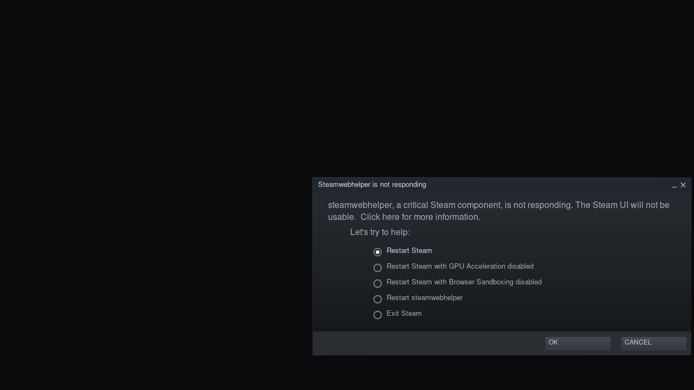

# Test results

Every row says where and when it ran. "Not run" means exactly that. No result
here comes from an iPad yet.

## Session 1: 2026-11-11, Windows 11 development PC (Intel i5-14600K), no Mac, no iPad

### Verified here

| What | Result | How |
|---|---|---|
| Core unit tests (native Windows x86-64, Zig clang 19) | **32 tests, 327 checks, 0 failures** | `python tools/build_core.py test` |
| Bugs the tests caught and that were fixed | QMP negotiation id collided with a command queued before the greeting. The journal demoted running steps on every load (broke the C API between calls). | tests in `core/tests/test_vm.cpp` |
| Guest agent unit tests (Windows) | **3 tests, 11 checks, 0 failures** (the uinput mapping test only compiles for Linux; CI runs it on arm64 Linux) | `python tools/build_core.py agent` |
| Cross-compile for the guest | `ideck-agent` (733 KB), `ideck-bench`, core and agent tests: aarch64-linux-musl and x86_64-linux-musl, **no warnings with `-Werror`** | `build_core.py all --target aarch64-linux-musl` |
| Python tests | **11 run, 0 failures, 2 skipped** on Windows (the POSIX symlink/exec-bit install test runs in CI) | `python -m unittest discover -s guest/tests` |
| Steam bootstrapper against Valve's live data | Parsed the real `steam_client_linuxarm64` manifest (version 1792618285); selected `steam_linuxarm64` and `bins_linuxarm64_linuxarm64` | `RealManifestFormatTests` with `IDECK_STEAM_MANIFEST` |
| ARM64 Steam client packages | Downloaded `steam_linuxarm64` (4,552,071 B) and `bins_linuxarm64_linuxarm64` (110,383,070 B); **both SHA-256 matched the manifest**; `steamrtarm64/steam` is ELF AArch64; zip entries carry no exec bits (so the bootstrapper restores them) | curl, sha256sum, Python zipfile |
| Core C API through ctypes (the path the CI boot test uses) | Built the exact desktop-test QEMU command line; `memory.plan` on 12 GiB / 6 GiB limit → **3072 MiB guest, 384 MiB TB cache**; controller packet encoding correct | `ideck_core.dll` + `tools/ideck_host.py` classes |
| Shell scripts | `bash -n` clean for all 10 scripts | Git Bash |
| Python files | `py_compile` clean | |
| Native benchmark baseline (Windows x86-64, not iPad) | int 2344 Mops/s · fp 9692 MFLOP/s · 20-thread int 16110 Mops/s (6.87×) · memcpy 4590 MB/s · read 8710 MB/s · latency 106.7 ns · ipc 9.67 Gops/s | `ideck-bench.exe` |

### Written but not compiled or run here

| Component | Why not | Where it gets verified |
|---|---|---|
| iOS app (Swift, Objective-C, XcodeGen project) | needs Xcode / the iOS SDK | `ios.yml` on a macOS runner |
| UTM sysroot fetch/build | needs macOS | `ios.yml` |
| Linux image (`linux/build-image.sh`) | needs root on arm64 Linux | `runtime.yml` on `ubuntu-24.04-arm` |
| Boot test: agent ready, virtual controller, provisioning, Steam install, benchmark in the guest, screenshots | needs the image | `runtime.yml` |
| Steam client actually starting in the guest | needs the boot test, then a device | `runtime.yml` screenshots, then iPad |
| JIT with StikDebug, Venus over MoltenVK, SPICE display, audio, controllers on iPad | needs an iPad | device |
| Any game | needs all of the above | device |

## Session 2: 2026-11-11, GitHub Actions (repo `ahmedps520-svg/iDeck`)

### CI (`ci.yml`, commit `cbcae63`): all 8 jobs green

Core and agent tests on Windows 2025, Ubuntu 24.04 x64, Ubuntu 24.04 arm64
and macOS 15; core built with AppleClang/CMake; arm64 test binaries and
`ideck-bench --quick` run under qemu-user; shellcheck and `py_compile` lint.
On arm64 Linux this includes the uinput mapping test and the POSIX
end-to-end Steam bootstrap test that are skipped on Windows.

### Linux runtime 0.1.1 boot test (`runtime.yml` run 42999579844, `ubuntu-24.04-arm`, QEMU 8.2 TCG, `-cpu neoverse-n1`, 4 vCPU, 4 GiB)

Not an iPad: this is the same image and agent protocol under TCG on a GitHub
arm64 server core, with no GPU passthrough (`desktop-test` profile).

| Check | Result |
|---|---|
| Image build (mmdebstrap Debian 13 + backports Mesa 26.1.6, kernel 6.12.116) | ✓ about 75 s |
| Boot to agent `ready` | ✓ **34.4 s** |
| Virtual controller from a host packet | ✓ `Microsoft X-Box 360 pad (iDeck 1)` appeared in `/proc/bus/input/devices` |
| Provisioning: Steam ARM64 client bootstrap | ✓ 2 packages, manifest 1792618285, `steamrtarm64/steam` installed |
| Provisioning: FEX RootFS | ✓ Ubuntu 24.04 EroFS downloaded, hash-checked, mounted at `/usr/share/guestos/fex-mesa` |
| Self-test | 14/16. **Failed: opengl and vulkan → llvmpipe** (expected, because the CI profile has no virgl/Venus). Passed: 4 KiB pages, LSE, LRCPC, library disk (ext4 formatted on first boot), DNS, DRM render node, uinput, agent, Steam binary, FEX RootFS, user namespaces |
| Audio | reported "ok" with sink `auto_null`, which is PipeWire's dummy sink (the CI profile has no sound device). The self-test was then fixed to fail on `auto_null`. |
| Steam service | ✓ `ideck-steam` active with Steam processes; the PIDs changed during the run (a self-update restart) |
| Steam window | **not seen** within about 6 minutes of screenshots (the X session background only). The next boot test waits up to 60 minutes and saves Steam's journal. |
| Clean shutdown via agent | ✓ QEMU exit 0 |

Guest CPU benchmark (`ideck-bench`, inside the TCG guest on the runner):

| Benchmark | Result |
|---|---|
| int_single | 2698 Mops/s |
| fp_single | 220 MFLOP/s |
| int_multi (4 vCPU) | 10171 Mops/s (3.77×) |
| mem_bandwidth (memcpy) | 366 MB/s |
| mem_read | 3702 MB/s |
| mem_latency | 523 ns |
| syscall | 25.4 µs |
| ipc | 2.16 Gops/s |
| jit_translate | 14.1 µs per block (warm 0.37 µs) |

What this tells us: integer code translates well. Floating point, memcpy and
syscalls are the TCG bottlenecks (soft-float helpers, byte-wise memory
helpers, full exception round trips). The iPad's M5 will have different
absolute numbers.

### Linux runtime 0.1.2 boot test (run 43004292541): Steam UI did not load

Boot 34.8 s; provisioning, controller, benchmark and shutdown as for 0.1.1.
The new 60-minute Steam-window wait and the saved journal showed the client
**crashing in a loop (296 restarts)**:

```
dlmopen steamui.so failed: libgtk-x11-2.0.so.0: cannot open shared object file
Fatal error: Failed to load steamui.so
```

The updater, manifest check and download hosts all worked under TCG. Two
causes, fixed for 0.1.3:

1. **Missing system libraries.** The `DT_NEEDED` entries of every ELF in the real `bins_linuxarm64_linuxarm64` package were parsed. Added to `linux/packages.txt`: GTK2 (`libgtk2.0-0t64`), OpenAL, libnm, SDL2, libavif, ICE/SM, fontconfig, freetype, libsndfile, libasyncns, libssh2, brotli, OpenSSL 3, libX11-xcb, libpipewire and the X extensions.
2. **Minimal install never completed.** With only the 2 core packages, the client reported "installed version == manifest version … Nothing to do" and never fetched CEF (`libcef.so`), SDL3 or the codecs. The bootstrapper now installs the full set by default (34 packages, 996 MB), and `--check` requires a recorded full install.

A new self-test check (`steam-libs`) runs `ldd` on the client's main binaries
and names any library that does not resolve.

### First device run (iPad17,2 = M5 iPad Pro, iPadOS 27.2, build 9)

| Finding | Fix |
|---|---|
| QEMU exited 36 ms after start: `Property 'virtio-gpu-gl-pci.refresh_rate' not found` | removed the property (build 10) |
| App memory limit measured at **5120 MiB** (5110 MiB available at launch), so the planner chose a 2 GiB guest | planner retuned: 3 GiB at this limit (build 10) |
| `CS_DEBUGGED` true but `P_TRACED` false: StikDebug attached and detached at once (no script assigned to an unknown app) | in-app JIT request with `script-name=legacy.js`, and P_TRACED required on iPadOS 26+ (build 11) |

### Device run, build 15 (iPad17,2, iPadOS 27.2, runtime 0.1.1)

Measured from `ideck.log`, `qemu.log` and `console.log` shared from the device:

- JIT through StikDebug legacy.js: `CS_DEBUGGED` true, `traced` true.
- Linux reached the guest agent **10 s** after QEMU started (guest 3072 MiB, 4 vCPU, TB cache 384 MiB).
- In-guest setup: `install-steam` done (the 0.1.1 minimal client), `install-compat` done (FEX RootFS downloaded, verified and mounted).
- `init-graphics` failed. Every Venus blob creation failed: `virtio_gpu_virgl_process_cmd: ctrl 0x10c, error 0x1200` (RESOURCE_CREATE_BLOB → ERR_UNSPEC), followed by MAP/UNMAP_BLOB and UNREF failing for the missing resource. This happened once per provisioning attempt.
- iPadOS terminated iDeck about 75 s into setup. `crash.log` was empty, so no signal reached the app, which points to a memory kill. The trace showed the app footprint climbing steadily while the guest itself reported only 133–386 MiB used:

  | Time | Footprint | Available |
  |---|---|---|
  | 12:39:21 | 857 MiB | 4262 MiB |
  | 12:40:01 | 2282 MiB | 2837 MiB |
  | 12:40:31 | 3228 MiB | 1891 MiB |

  The growth matches guest RAM being touched by page cache during the Steam and FEX downloads. Guest RAM is anonymous memory, so all of it is charged to the app. The installer's `provision.retry` then restarted provisioning twice, re-running the GPU probes each time.

| Finding | Fix (build 16) |
|---|---|
| Guest page cache charged to the app footprint | guest RAM in a shared file mapping in Caches (`memory-backend-file,share=on`), on by default; no balloon in that mode (QEMU cannot discard file-backed RAM on Darwin) |
| Venus blob memory: UTM's virglrenderer uses `shm_open("<app group>/<hex>")`, which the sandbox allows only for an app group in the code signature | at launch, read the signed entitlements (csops) and probe shm under each candidate group; Vulkan is turned off for the session when none works (OpenGL is unaffected) and the reason is logged |
| A failed graphics check stopped setup and triggered retries | `vulkan` is an optional check; a step with only optional failures ends as `warning` and setup continues; the automatic retry is only for the download steps; step details are logged |
| The device stayed on runtime 0.1.1 | the newer-runtime check now runs until setup completes, not only before the first boot |

### Linux runtime 0.1.3 boot test (run 43015376314): Steam install failed on layout

- Boot to agent in 34 s.
- FEX RootFS mounted (Ubuntu 24.04 EroFS).
- `steam-libs`: "all client libraries resolve", so the 0.1.2 GTK gap is closed.
- The full Steam install (34 packages, 996 MB) extracted every package, then failed with `/home/deck/.local/share/Steam/steamrt64 exists and is a directory`. Checked from the published zips:
  - `steam_steamrt_linuxarm64` ships `steamrt64/steam` as an x86-64 ELF (`e_machine` 0x3e).
  - `bins_steamrt_linuxarm64` puts x86-64 client libraries in `steamrt64/` and x86 ones in `steamrt32/`.
  - The bootstrap's `steamrt64 → steamrtarm64` link collided with that real directory.
- `ideck-steam.service` then re-ran the whole install on every restart: 14 restarts, about 4 min CPU and a 2.4 GB memory peak each.
- `steam_window_seen` was false.
- GL, Vulkan (llvmpipe) and audio (`auto_null`) failed as expected on a CI runner with no GPU or sound device.

### Device run, build 16 (iPad17,2, iPadOS 27.2, runtime 0.1.1 → 0.1.2)

- The code signature has **no app group** (`app groups []`; the group in the logs came from the Info.plist fallback). `shm_open("group.com.ideck.app/…")` failed with EPERM, so Vulkan was turned off for the session as designed.
- Guest RAM was file-backed. The footprint was 610 MiB after QEMU start (857 MiB in build 15) and 1002 MiB with the guest at 514 MiB used. No memory termination in this session.
- OpenGL: `virgl`, OpenGL 2.1, Mesa 26.1.6.
- Runtime 0.1.2 still treats Vulkan as required, so `init-graphics` failed and setup stopped. The guest-side change ships in the runtime, not in the app.
- In the session before that, iDeck was launched with JIT attached, then spent 52 s installing runtime 0.1.2 before starting QEMU. It died with SIGTRAP in `tcg_region_init`: QEMU's `brk #0x69` JIT request was never answered. Boots 1–6 s after StikDebug attached worked.

| Finding | Fix (runtime 0.1.4, build 17) |
|---|---|
| `steamrt64` layout collision; a full install over the old link would mix x86-64 files into `steamrtarm64/` | no link and no `.steam-enable-steamrt64-client` flag; an old link is removed together with `steamrtarm64/`, which is reinstalled; extraction refuses to write through symlinks; a complete install requires an AArch64 `steamrtarm64/steam` |
| Install restarted from scratch on every service restart | a retry keeps the packages already extracted; `ideck-steam.service` waits 20 s between restarts and stops after 4 starts in 15 min |
| JIT request unanswered after a long gap | QEMU is not started when the debugger attached more than 45 s earlier; iDeck asks for a relaunch with JIT instead of crashing |

### Linux runtime 0.1.4 boot test (run 43061237530): the Steam client starts

QEMU 8.2 TCG on `ubuntu-24.04-arm`, no GPU and no sound device.

**Setup and launch**
- Boot to the agent took 34 s.
- `install-steam`: "installed 34 packages" (client version `1792618285`, full set), with no layout error. `install-compat`: FEX RootFS mounted. Provisioning finished at 498 s.
- `ideck-steam.service` started `steamrtarm64/steam` (native ARM64), which ran "Verifying installation…".
- `steam_window_seen: true`, for the first time. `screen-01.png` shows the client's own native dialog:

  

**Problems seen**
- The Steam UI did not load. `steamwebhelper` (CEF) logged `Failed creating offscreen shared JS context`, and the client showed "Steamwebhelper is not responding" with its own recovery options. Not yet separated: slowness (TCG with llvmpipe on a CI runner) versus a real CEF problem. The next things to try are the software-UI switch (`-cef-disable-gpu`) and the device's JIT speed.
- The client then started its self-update (667,975 KB): it reported "Package file … missing or incorrect size" for its `package/*.zip.vz.*` cache, which the bootstrap does not keep. At 800 s the main process died with SIGBUS (`status=7/BUS`). The service restarted it 20 s later, and the update resumed (312,428 KB left) when the test ended.
- The client wrote crash dumps and uploaded them to Valve's crash reporter (`CrashID=bp-…`). That is Steam's own behaviour, not iDeck's.
- GL and Vulkan (llvmpipe) and audio (`auto_null`) failed as expected on the runner.

### Device run, build 17 with runtime 0.1.4 (iPad17,2, iPadOS 27.2)

- Reported by the user: setup finished without iDeck closing.
- "Resume Steam" showed a black screen with no mouse pointer. Guest CPU stayed at 8–11%, so Steam was not busy updating.
- `qemu.log`: all SPICE channels opened (main, display, cursor, inputs, playback). No virtio-gpu or GL errors.
- `console.log`: `ideck-session.service` (Xorg) and the deck user session started.
- Nothing in the app recorded the display client's state: no object was registered for its events, so `ideck.log` had no display lines.
- Build 18 adds display diagnostics:
  - display events in the log;
  - a state line (channel, size, frame texture, renderer and view);
  - `display.png`, the last frame received from Linux, included in Share logs;
  - CocoaSpice and spice-gtk debug output for the first two minutes.

### iOS app builds (`ios.yml`)

| Attempt | Result | Fix |
|---|---|---|
| 1 | 9 Swift errors in 3 files | `NS_SWIFT_NAME` for IDSpiceClient (Swift had renamed `sendMouseButton` to `send`); `StatTile` argument order |
| 2 | all sources compiled; link: GStreamer static libs not found | `$(SYSROOT_DIR)`-based paths in the generated xcconfig |
| 3 | link: `framework 'Compression' not found` | link `libcompression.tbd` |
| 4 | link: `GLESv2` "not an allowed client" | skip frameworks with `LC_SUB_CLIENT` when generating link flags |
| 5 | **IPA built** (146 MB): it embedded all 93 UTM frameworks and every QEMU target | embed only the dependency closure |
| 6 (`6a8f9e6`) | **IPA built, 19 MB** (75.7 MB unpacked), 37 frameworks | — |

Static checks on the attempt 6 IPA (Mach-O load commands parsed from the
archive; `tools`-style script, not run on a device):

- Every `@rpath` dependency of the app binary and `qemu-aarch64-softmmu` is present. Nothing is missing.
- The runtime-`dlopen` libraries are embedded: MoltenVK, plus EGL and GLESv2 (ANGLE).
- `vulkan/icd.d/MoltenVK_icd.json` → `../../Frameworks/MoltenVK.framework/MoltenVK` resolves inside the bundle (Vulkan API 1.4.0).
- Info.plist: `com.ideck.app`, edition `jit`, app group `group.com.ideck.app`, manifest URL `…/releases/download/runtime-latest/manifest.json`.

## How to add results

- **CI runs:** the `runtime.yml` boot test writes `out/boot-test/report.json`, `bench.json` and `screen-*.png` (workflow artifact). Copy the key numbers into a new section here with the run URL.
- **Device runs:** record the iPad model, iPadOS version, runtime version, app build, the self-test report (Runtime › Run Self-Test › share), the benchmark JSON (Performance › Share results) and per-game observations ([COMPATIBILITY](COMPATIBILITY.md)).
